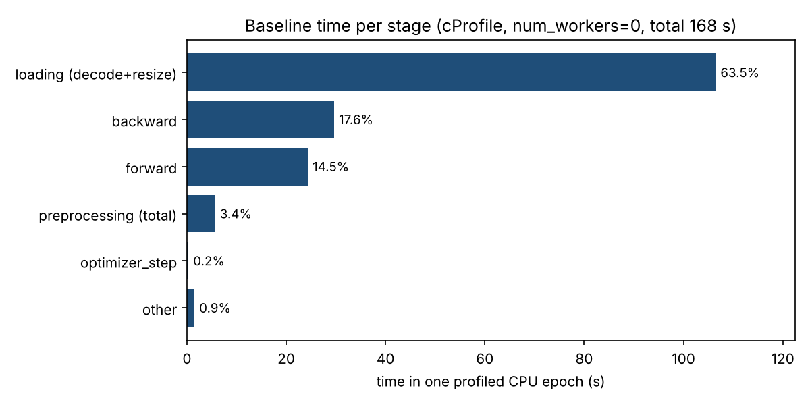

# Lab notebook

One entry per experiment. Write the prediction BEFORE you run anything. A wrong prediction with a good explanation is worth more than a right one you cannot explain.

## Entry template

```
### <assignment id> <short title>          date: <yyyy-mm-dd>
Config / commit:      <config file and git commit hash>
Question:             <what do you want to find out?>
Prediction:           <number or ranking, and the reason, written before the run>
Command:              <exact command line>
Result:               <measured numbers: mean +/- std, n repeats, cold vs steady>
Prediction vs result: <what was different?>
Explanation:          <why? what evidence supports it (profiler output, a second measurement)?>
Decision:             <keep / drop the change, and what you do next>
```

## A1.3 Baseline configuration review

1. **Alignment with the project brief (Sections 3, 4, and 7):**
   - `seed: 42`: Required by the brief to ensure reproducible dataset splitting, shuffling, and weight initialization.
   - `data.root: data/dr_dataset`, `data.image_size: [224, 224]`, `data.num_classes: 5`: Required 5-class diabetic retinopathy grading task (classes 0 to 4) at fixed $224 \times 224$ RGB resolution.
   - `data.train_frac: 0.70`, `data.val_frac: 0.15`: Required 70% train / 15% validation / 15% test split ($1 - 0.70 - 0.15 = 0.15$).
   - `data.batch_size: 32`, `data.num_workers: 2`: Baseline DataLoader settings before pipeline optimization.
   - `preprocess` (`clahe: true`, `circular_crop: true`, `normalize: true`, `gamma: 1.0`): Required Module B preprocessing steps (circular fundus mask, local contrast enhancement via CLAHE, and per-channel normalization).
   - `train` (`model: reference_cnn`, `epochs: 5`, `lr: 0.001`, `amp: false`, `weight_decay: 0.0`, `label_smoothing: 0.0`): Required Module E reference CNN trained in FP32 (`amp: false`) for 5 epochs with AdamW (`lr = 1e-3`).

2. **Patient-level split enforcement:**
   - Yes, the split is strictly patient-level so that multiple fundus photographs (left/right eye or repeated captures) from the same patient never appear across both `train` and `val`/`test` (preventing data leakage and artificially inflated validation/test accuracy).
   - This is enforced in `src/data_loader.py` by `patient_id(path)` (which parses the patient identifier prefix before `_` in each filename) and `split_by_patient(items, train_frac, val_frac, seed)` (called inside `make_loaders`).

3. **Checkpoint selection rule and test-set isolation:**
   - In `src/train.py`, `checkpoints/<run>/best.pt` is overwritten at the end of an epoch if and only if validation accuracy strictly improves (`if va_acc > best_val: best_val = va_acc; torch.save(...)`).
   - It is completely free of test-set leakage: `src/train.py` only requests `which=("train", "val")` from `make_loaders`. The `test` split is never loaded during training or model selection and is used exclusively in `src/evaluate.py`.

4. **Keys kept identical vs keys added in `configs/optimized.yaml` for a fair comparison:**
   - **Kept identical:** `data.root`, `data.num_classes: 5`, `data.train_frac: 0.70`, `data.val_frac: 0.15`, `data.split_seed: 42` (locked to baseline `seed: 42` so patient splits remain identical across all experiments and random seeds), and `train.epochs: 5` (identical training budget).
   - **Added / updated in `configs/optimized.yaml`:**
     - Data loading & caching (A3, A5): `data.split_seed: 42`, `data.cache: true` (uint8 `np.memmap` decoded cache), `data.pin_memory: true`, `data.persistent_workers: true`, `data.prefetch_factor: 2`, `data.prefetch_gpu: true` (`CudaPrefetcher`), and tuned `data.batch_size` / `data.num_workers`.
     - GPU preprocessing & augmentation (A4, A5): `preprocess.gpu: true` (`preprocess_batch_gpu` operating on uint8 batches transferred over PCIe) and `preprocess.augment: true` (`augment_batch_gpu`).
     - Training acceleration & model redesign (A6): `train.amp: true` (`torch.autocast` + `GradScaler`), `train.channels_last: true` (NHWC layout for Tensor Cores), `train.compile: false` (evaluated in A6.3, disabled by default due to 26.7 s cold-epoch compilation overhead and Windows incompatibility), and model redesign keys (`train.model`, `train.scheduler`, `train.weight_decay`, `train.label_smoothing`).

## A1.5 Decision on `torch.backends.cudnn.benchmark`

- **Baseline (`benchmark = False`, `deterministic = True`):** The baseline requires strict run-to-run reproducibility so that fixing `seed` produces identical loss and accuracy trajectories. Leaving `benchmark = False` prevents timing noise during cuDNN autotuning from picking different convolution algorithms (which accumulate floating-point sums in different orders) and avoids one-off search overhead on short verification runs.
- **GPU Benchmarks & Optimized Pipeline (`benchmark = True` with warm-up / separate cold-epoch reporting):** Because all input batches have a fixed spatial shape `(B, 3, 224, 224)` (especially with `drop_last=True`), cuDNN autotuning pays a one-time search cost on the first batch to benchmark candidate convolution algorithms (Winograd, implicit GEMM, Tensor Core NHWC kernels) and caches the fastest kernel for all subsequent batches. In micro-benchmarks, warm-up runs absorb this search cost; in full training (`src/train.py`), reporting `cold_epoch_s` separately from `steady_epoch_s` isolates first-epoch initialization from steady-state throughput.

## A1.6 Source code walkthrough: mapping Modules A-E to functions

- **Module A — Data loading, patient-safe splitting, and caching (`src/data_loader.py`, `src/prefetcher.py`):**
  - `find_images(root)`: scans class subfolders `0..4` and returns `(filepath, label)` pairs.
  - `patient_id(path)` & `split_by_patient(items, train_frac, val_frac, seed)`: groups images by patient ID and partitions patients into disjoint `train`, `val`, and `test` splits.
  - `build_cache(items, image_size, cache_dir, workers)`: decodes and resizes images once into a read-only `uint8` `np.memmap` array on disk (A3.1).
  - `DRDataset` (`load`, `__getitem__`): loads decoded RGB images (from disk or memmap cache) and applies CPU transforms or returns raw `uint8` CHW tensors when `gpu_preprocess=True`.
  - `make_loaders(cfg, device_type, gpu_preprocess, which)`: builds PyTorch `DataLoader` instances for each split.
  - `CudaPrefetcher` (`src/prefetcher.py`): overlaps host-to-device transfers with GPU compute using a dedicated CUDA stream (A5.2).
- **Module B — Image preprocessing (`src/preprocess_cpu.py`, `src/preprocess_gpu.py`):**
  - *CPU (`src/preprocess_cpu.py`):* `circular_crop(img)` (retinal field-of-view circular mask), `apply_clahe(img, clip_limit, tile_grid_size)` (OpenCV LAB-space CLAHE), `contrast_stretch(img)`, `normalize(img, mean, std)`, orchestrated by `preprocess_image(img, cfg, rng)` and `PreprocessTransform`.
  - *GPU (`src/preprocess_gpu.py`):* `circular_crop_gpu(batch)`, `clahe_gpu(batch, clip_limit, tile_grid_size)` (batched CIE L* 8x8 tile histogram equalization with `scatter_add_` and bilinear LUT interpolation), `contrast_stretch_gpu(batch)`, `normalize_gpu(batch, mean, std)`, orchestrated on GPU batches by `preprocess_batch_gpu(batch, cfg, augment, device)`.
- **Module C — Spatial filtering and denoising (`src/filters_cpu.py`, `src/filters_gpu.py`, `src/filters_numba.py`):**
  - *CPU (`src/filters_cpu.py`):* `gaussian_filter(img, ksize, sigma)` (`cv2.GaussianBlur`) and `median_filter(img, ksize)` (`cv2.medianBlur`).
  - *GPU (`src/filters_gpu.py`, `src/filters_numba.py`):* `gaussian_filter_gpu(batch, ksize, sigma)` (separable 1D depthwise convolutions), `median_filter_gpu(batch, ksize)` (`F.unfold` + `torch.median`), and `median_filter_numba(batch, ksize)` (custom 2D CUDA kernel via Numba).
- **Module D — Data augmentation (`src/preprocess_cpu.py`, `src/preprocess_gpu.py`):**
  - *CPU:* `augment_image(img, rng)` (random horizontal/vertical flips and $90^\circ$ rotations, applied only to the training split inside `preprocess_image`).
  - *GPU:* `augment_batch_gpu(batch)` (vectorized per-image random flips and $90^\circ$ rotations on GPU batches inside `preprocess_batch_gpu` when `augment=True`).
- **Module E — Model architecture, training loop, and evaluation (`src/model.py`, `src/train.py`, `src/train_cpu.py`, `src/train_gpu.py`, `src/evaluate.py`):**
  - *Model (`src/model.py`):* `ReferenceCNN` (4-stage Conv-BN-ReLU-MaxPool backbone + `AdaptiveAvgPool2d` + linear classifier) and `build_model(name, num_classes)` (`reference_cnn` or `resnet18`).
  - *Training (`src/train.py`, `src/train_cpu.py`, `src/train_gpu.py`):* `run_epoch` (single-epoch forward/backward pass with on-device metric accumulation, AMP `autocast` + `GradScaler`, and `channels_last`), `macro_f1(conf)`, `resolve_gpu_preprocess`, `make_gpu_pre`, and `main` (epoch loop, AdamW/CosineAnnealingLR, peak VRAM tracking, validation-only checkpointing to `best.pt`, and logging to `history.json`).
  - *Evaluation (`src/evaluate.py`):* `main` (loads `best.pt`, runs final test-set inference under `torch.no_grad()` matching training precision/memory layout, and writes accuracy, macro P/R/F1, per-class metrics, confusion matrix, and inference throughput to `metrics.json`).

## Entries
### A1.4 Data split verification (P1: Fatima Zahrae )          date: 2026-11-12
Config / commit:      configs/baseline.yaml, commit $commit
Question:             Are the classes still balanced inside each split? Does any patient
                      appear in two splits?

Prediction:           (none written before the run)
Command:              python check_split.py (the brief's script + an overlap test)
Result:               split  images  patients   class 0 / 1 / 2 / 3 / 4
                      train   2116     1342     343 / 489 / 418 / 453 / 413
                      val      425      287      83 / 104 /  76 /  78 /  84
                      test     458      289      78 / 108 /  89 / 101 /  82
                      Shared patients: train & val = 0, train & test = 0, val & test = 0.
                      Total: 2116 + 425 + 458 = 2999 images, as expected.
Prediction vs result: -
Explanation:          Balance: the full dataset is almost balanced (504 / 701 / 583 / 632 / 579).
                      The share of each class stays close across the three splits (class 1:
                      23.1% in train, 24.5% in val, 23.6% in test). The largest gaps are class 0
                      (16.2% in train, 19.5% in val) and class 3 (21.4% in train, 18.4% in val),
                      probably because val is small (425 images). The splits are comparable.
                      Data leakage: no patient id is in two splits.
                      Why patient-level: images of the same patient look alike (same person,
                      same camera, same anatomy). With an image-level split, near-duplicates
                      would be in both training and validation. The model could recognize the
                      patient instead of learning the disease, and the validation accuracy
                      would be too optimistic. With a patient-level split, it better estimates
                      the performance on new patients. I did not measure by how much it would
                      be inflated.
Decision:             Keep this split for all comparisons (data.split_seed fixed).


### A1.5 torch.backends.cudnn.benchmark setting (P1: Fatima zahrae)          date: 2026-11-12
Config / commit:      configs/baseline.yaml, commit $commit
Question:             How should torch.backends.cudnn.benchmark be set for the baseline and for
                      the benchmarks, and why?
Prediction:           (none written before the decision)
Command:              Select-String -Path src\*.py -Pattern "cudnn"
Result:               The setting only matters on the GPU: it makes cuDNN try several
                      convolution algorithms the first time it sees an input shape, then keep the
                      fastest one.
Prediction vs result: -
Explanation:          Baseline (CPU): the baseline runs on the CPU, where cuDNN is not used, so
                      the flag has no effect. Keep the default (False) so the baseline stays
                      simple and reproducible.
                      GPU benchmarks: use True, because the input shape is fixed (224x224, same
                      batch size). Two precautions: (1) the first pass is slower because the
                      algorithms are tested, so a warm-up is needed and the cold first epoch is
                      reported separately; (2) the chosen algorithm can change between runs, so
                      results are not always identical to the last bit. For correctness tests
                      (CPU/GPU equivalence) use a tolerance or set it to False.
                      A different last batch size triggers a new search, which is one more
                      reason to use drop_last=True on the train loader.
Decision:             False for the CPU baseline, True for the GPU benchmarks. The same value
                      must be used in every comparison, and it is written in the config file.

### A1.7 / A1.8 CPU baseline run (P1: Fatima Zahrae)          date: 2026-11-12
Config / commit:      configs/baseline.yaml, commit dd9e6c7
Question:             What are the validation accuracy and the time per epoch of the CPU baseline?
Prediction:           (none written before the run)
Command:              python src/train_cpu.py
Result:               RTX 3050 laptop, CPU i5-13420H, charger plugged in, Best performance.
                      5 epochs, best val_acc = 0.3859 (val_f1 at the last epoch = 0.3356),
                      wall time = 564.4 s, about 23 img/s.
                      train_time per epoch: 93.41, 93.55, 91.72, 90.65, 95.72 s.
                      Steady epochs (1 to 4): mean 92.9 s +/- 2.2 s. Cold epoch (0): 93.41 s.
                      setup_time_s = 2.515521000023 s
Prediction vs result: -
Explanation:          One-time costs: setup (2.52 s) and the cold first epoch. The first epoch is
                      not slower than the others (93.41 s vs 92.9 s average), so there is no
                      visible cold-start cost on CPU. Repeated cost: about 93 s per epoch, paid
                      at every epoch.
                      The 5 train_time values add up to 465 s but the wall time is 564 s. Setup
                      explains only 2.5 s of the 99 s gap. The rest is probably validation after
                      each epoch (about 19 s per epoch), not confirmed yet.
Decision:             Keep this run as the baseline everything is compared against. Test set not
                      used (evaluate.py is for A7).
Add-Content -Path docs\lab_notebook.md -Value @"

### A1.10 Checkpoint questions (P1: Fatima zahrae)          date: 2026-11-15
Config / commit:      configs/baseline.yaml, commit $commit

Q1. Which stages run once, and which run every epoch?
  Run once:           listing the images and splitting by patient, building the model and the
                      loaders. Measured setup_time_s = 2.52 s.
  Run every epoch:    loading (decode + resize), preprocessing (circular crop, CLAHE,
                      normalize), forward, backward, optimizer step, and the validation pass
                      (val_acc is printed after every epoch). Loading is 63.5% of an epoch in
                      the profile, because the baseline has no cache yet. Augmentation is off
                      in the baseline (augment=False).
  In the optimized design: decoding becomes a one-time cost thanks to the decoded-image cache
  (A3).

Q2. How many bytes does one batch occupy as uint8 and as float32 at 224x224?
  One image has 224 x 224 x 3 = 150528 values.
  uint8 (1 byte each):    150528 bytes per image.
  float32 (4 bytes each): 602112 bytes per image.
  With batch size $B:     uint8 = $u8 bytes ($u8mb MB), float32 = $f32 bytes ($f32mb MB).
  float32 is always 4 times larger than uint8, so copying uint8 to the GPU and converting to
  float32 there moves 4 times fewer bytes. This assumes 3 channels.

Q3. What does drop_last=True on the train loader change in the throughput numbers?
  With 2116 training images and batch size $B there are $full full batches. drop_last=True
  removes the last incomplete batch, so $drop images are skipped in an epoch ($pct% of 2116).
  The effect on images per second is tiny: it is at most about that percentage. All batches
  have the same shape, which avoids a new cudnn.benchmark search and torch.compile
  recompilation, and avoids a batch of size 1 for BatchNorm. If the shuffle changes each
  epoch, the skipped images differ every epoch, so no image is lost for good.
### A5.9 Precomputed preprocessing vs on-the-fly GPU preprocessing (2026-11-13)

- **Config / commit:** `configs/optimized.yaml` @ 0a084f8
- **Question:** is it faster to (a) store the final preprocessed float tensors on disk, or (b) compute them on the GPU every epoch?
- **Prediction:** on-the-fly GPU preprocessing wins. The uint8 cache (A3) is 4x smaller than float32 on disk, and GPU CLAHE/normalize should cost on the order of milliseconds per batch (to be confirmed with the GPU preprocessing row of `results/timing.csv`, A5.6-5.7, not measured yet).
- **Command:** analysis. The storage sizes below are computed; check the cache size with `ls -lh data/cache/`.
- **Result:**
  - **Storage:** 3000 images x 3 x 224 x 224 x 4 bytes (float32) = 1.81 GB on disk for precomputed float tensors; the uint8 cache from A3 is 3000 x 224 x 224 x 3 = 451 MB (4x smaller).
  - **Memory:** a precomputed pipeline still loads each batch from disk into RAM, then copies it to the GPU. The on-the-fly GPU pipeline loads uint8 (4x less host memory pressure per batch), and the GPU is expected to do CLAHE/normalize in milliseconds (not yet measured).
  - **Augmentation:** precomputed augmented copies multiply storage by the number of augmentations and lose randomness. On-the-fly GPU augmentation (`preprocess_gpu.augment_gpu`) is fresh every epoch. The brief's Module D asks exactly this: random augmentation must be on the fly.
- **Prediction vs result:** the storage side is confirmed by arithmetic (4x). The timing side is not measured yet and depends on the GPU preprocessing row of `timing.csv` (A5.6-5.7).
- **Explanation:** the A3 cache file (451 MB) is 4x smaller than the precomputed float32 size (1.81 GB). Precomputed augmentation also loses randomness, which violates Module D's "random augmentation on the fly" rule. The timing comparison will be backed by `results/timing.csv` once the GPU rows exist.
- **Decision:** keep the uint8 cache (A3), do preprocessing and augmentation on the GPU every epoch. Precomputed float tensors would only be worth it if GPU preprocessing time per batch exceeded the disk read of the float tensors; this must be confirmed with the `timing.csv` numbers.

### A5.10 Bytes over PCIe per epoch (2026-11-13)

- **Config / commit:** `configs/baseline.yaml` @ 0a084f8
- **Question:** how many bytes cross the PCIe bus per training epoch for CPU preprocessing vs GPU preprocessing?
- **Prediction:** CPU preprocessing: each batch crosses PCIe as float32 NCHW (already preprocessed on the host). GPU preprocessing: each batch crosses PCIe as uint8 NCHW (4x smaller). With 2116 train images and batch 32, expect about 66 batches, about 1.27 GB/epoch for the CPU path and about 0.32 GB/epoch for the GPU path.
- **Command:**

```bash
python -c "
import yaml
cfg = yaml.safe_load(open('configs/baseline.yaml'))
from src.data_loader import find_images, split_by_patient
s = split_by_patient(find_images(cfg['data']['root']),
    cfg['data']['train_frac'], cfg['data']['val_frac'], cfg['seed'])
n_train = len(s['train']); bs = cfg['data']['batch_size']
batches = n_train // bs
H = W = 224
cpu_bytes = batches * bs * 3 * H * W * 4
gpu_bytes = batches * bs * 3 * H * W * 1
print(f'train images: {n_train}, batches: {batches}')
print(f'CPU preprocessing: {cpu_bytes/1e9:.2f} GB/epoch over PCIe')
print(f'GPU preprocessing: {gpu_bytes/1e9:.2f} GB/epoch over PCIe (4x less)')
"
```

- **Result:**
  - train images: 2116, batches: 66
  - CPU preprocessing: 1.27 GB/epoch over PCIe
  - GPU preprocessing: 0.32 GB/epoch over PCIe (4x less)
- **Prediction vs result:** matches, but note that both are the same arithmetic: this is a calculation of the payload, not a measurement of the bus. The 4x reduction comes from shipping uint8 (1 byte per channel) instead of float32 (4 bytes per channel) over the same N x C x H x W layout.
- **Explanation:** with 2116 training images and batch 32, there are 66 batches (`drop_last=True`). CPU path: 66 x 32 x 3 x 224 x 224 x 4 bytes = 1.27 GB/epoch. GPU path: 66 x 32 x 3 x 224 x 224 x 1 byte = 0.32 GB/epoch. The 4x reduction is the algorithmic reason GPU preprocessing relieves the PCIe bus, on top of removing CPU decode/preprocess work.
- **Decision:** keep GPU preprocessing (uint8 over PCIe). The 4x PCIe reduction compounds with the CPU decode savings from A3 and the GPU compute offload from A4.

### A5.11 Checkpoint questions (2026-11-13)

- **Config / commit:** `configs/optimized.yaml` @ 0a084f8
- **Question:**
  - **Q1:** why does `non_blocking=True` do nothing useful for a tensor in pageable memory?
  - **Q2:** you doubled `num_workers` and nothing changed. Give three possible reasons and one measurement each.
  - **Q3:** why is Windows different from Linux for DataLoader workers, and what does that change?
- **Prediction:**
  - **Q1:** PyTorch must synchronously stage pageable data into a pinned buffer before the async DMA can run, so the transfer cannot overlap with compute.
  - **Q2:** the bottleneck moved to the GPU, or the disk, or the CPU core count.
  - **Q3:** Windows uses spawn; Linux can fork.
- **Command:** analysis-only checkpoint (backed by the assignment brief; the measurements named in Q2 are to be taken from `results/timing.csv` and `results/resources.csv`).
- **Result:**
  - **Q1:** `non_blocking=True` only earns its keep when the source is pinned (page-locked) host memory. For a tensor in pageable memory, PyTorch must first synchronously stage it into a pinned buffer before the async DMA can run, so the transfer cannot overlap with compute. The flag effectively degrades to a blocking copy. That is why A5.1 sets `pin_memory=True` on CUDA.
  - **Q2:** three possible reasons, one measurement each:
    - (a) The bottleneck is now the GPU, not the host. Measure GPU utilization with `nvidia-smi` / `resources.csv`; if the GPU is already above 90%, more workers cannot help.
    - (b) The disk is the limit (cache off, cold OS cache). Measure loading ms from `results/timing.csv` with cache on vs off.
    - (c) You hit the CPU core count (Colab gives about 2-4 cores). Measure `cpu_percent` in `resources.csv`; if it is pinned at 100%, more workers just thrash.
  - **Q3:** Windows uses spawn (fresh process, state re-imported) while Linux can fork. Spawn requires every transform and dataset to be picklable: no lambdas, no closures. That is why `CpuTransform` is a class, not a lambda, and why `make_gpu_pre`'s lambda is fine (it lives in the main process, never in a worker).
- **Prediction vs result:** matches prediction.
- **Explanation:** A5.1's `pin_memory=True` is the precondition for A5.4's `non_blocking=True` to actually overlap; without pinned memory, `non_blocking` does nothing useful. The worker sweep (`results/sweep_workers.csv`, A5.8, not run yet) will be the empirical version of Q2: the curve should flatten at the GPU-saturating worker count.
- **Decision:** A5.1-A5.5 done. A5.6-A5.8 are still open: hand `results/timing.csv` and `results/sweep_workers.csv` to the A8 figures script once they exist.

### A3.7 Cache checkpoint questions (2026-11-13)

- **Config / commit:** `configs/exp_cache.yaml` @ 924f019
- **Question:** when does a cache lose? Why must the file name depend on the image list and the size? Is the cache a CPU or GPU optimization, or both?
- **Prediction:** the cache wins when the dataset fits in RAM and is decoded every epoch; it loses when the dataset is too large, when augmentation must happen before resize, or when the image list changes often. The file name must hash paths + size to avoid serving a stale array. The cache benefits both CPU (decode) and GPU (4x smaller PCIe payload).
- **Command:** analysis-only checkpoint, no command. Cache code: `build_cache` in `src/data_loader.py`, see commits a53a4a8 and the A3.3 + A5.1 commit on `p2-loading`.
- **Result:**
  - **Q1:** a cache loses when (a) the dataset does not fit in RAM/disk (for example 300k images on a small SSD), (b) augmentation must be applied before resize (you cache unaugmented images but pay the augment cost every epoch anyway), or (c) the image list changes often (each change invalidates the md5 hash and forces a full rebuild).
  - **Q2:** the file name must depend on the image list and the size so a stale cache is never reused. If `image_size` changed 224 to 256, or images were added or removed, the old uint8 array would have the wrong shape or wrong content. The md5 over the paths plus the WxH suffix forces a rebuild exactly when inputs change.
  - **Q3:** both. The cache removes CPU decode work (CPU win) and lets workers return raw uint8 that the GPU preprocesses, shrinking the host-to-device copy 4x versus shipping float32. The GPU path still needs the uint8 pixels, and reading them from a memmap is far cheaper than re-decoding JPEGs every epoch.
- **Prediction vs result:** matches prediction. The cache is a win for our FDR26 size (3000 images, 451 MB cache) and our pipeline (uint8 feeds A5.3 GPU preprocessing).
- **Explanation:** `build_cache` writes a memmap of shape (N, H, W, 3) uint8 named `cache_<md5>_<N>x<H>x<W>x3.uint8`. The md5 covers `"\n".join(paths) + "|WxH"`, so any path or size change produces a different filename and the fast path `if os.path.exists(path)` is not taken, forcing a rebuild. `test_cache_matches_direct_decode` (8/8 passing on `p2-loading`) confirms `cache[i] == DRDataset.load(i)` for every i, so the two decode paths agree byte-for-byte. The 4x PCIe reduction (uint8 vs float32) is the algorithmic reason the cache also helps the GPU path; see A5.10 for the byte count.
- **Decision:** keep the cache. P1 runs A3.5 on the 3050 (no-cache vs first-run vs warm vs cold-OS); numbers go to `results/a3_cache_benchmark.csv` for the A8 figures. Move on to A5.2 (CudaPrefetcher).


### A2.3: Prediction of Time Distribution (CPU Baseline)

- **Prediction:** Preprocessing (CLAHE, cropping, and normalization) is expected to account for the largest share of the execution time per epoch, due to CPU color space conversions and the initial absence of caching.
- **Justification:** Sequential OpenCV operations block the pipeline before the forward pass even begins.

### A2.5 Per-stage CPU times on the same 64 images (P1: fatima zahrae)   date: 2026-11-20
Config / commit:      configs/baseline.yaml, commit $commit
Question:             How long does each stage take on the same 64 images (CPU), and which stage is the largest?
Prediction:           see the entry "A2.3 Prediction" (ranking written before the run).
Command:              run 1 (12 Nov): python benchmarks/benchmark_stages.py --n 64   (results/timing.csv)
                      run 2 (19 Nov): python benchmarks/benchmark_stages.py --config configs/baseline.yaml --n 64 --repeats 3 --out results/A35_nocache.csv
Result:               mean ms for 64 images (std), then ms per image:
                        stage             run 1 (12 Nov)           run 2 (19 Nov)         change
                        loading           2490.8 (290.2)  38.9     1959.5 (27.6)   30.6    -21%
                        preprocessing      214.7 (17.6)    3.35     126.0 (3.9)     1.97   -41%
                        filter_gaussian     21.7 (4.0)     0.34      16.3 (0.6)     0.25   -25%
                        filter_median       44.7 (3.5)     0.70      40.0 (0.7)     0.62   -11%
                        filter_green         6.8 (0.3)     0.11       6.1 (0.8)     0.09   -11%
                        filter_contrast    132.0 (17.6)    2.06     111.6 (4.0)     1.74   -15%
                        augmentation        27.8 (1.5)     0.43      20.0 (0.8)     0.31   -28%
                        train_step        1631.3 (167.6)  25.5     1514.9 (119.6)  23.7     -7%
                        inference          413.4 (9.7)     6.46     392.7 (9.4)     6.14    -5%
                      Other measurements of loading per image: epoch profile 50.3 ms (106.45 s / 2116 images, cProfile overhead); bench_cache.py no-cache case 54.4 ms.
Prediction vs result: Loading is the largest stage in both runs (38.9 and 30.6 ms per image), above train_step (25.5 and 23.7), which agrees with the epoch profile (loading 63.5 percent). train_step is forward + backward + optimizer together, so it cannot be compared one to one with my A2.3 ranking, which put loading third and was wrong.
Explanation:          All nine stages are faster in run 2 (5 to 41 percent) and the spread is much smaller, which points to different machine conditions or code rather than to one stage. benchmark_stages.py was updated by git pull between the two runs, so a code change is one possible cause; I did not check, and I did not find the cause. The ranking is the same in both runs, so it is reliable; the exact milliseconds are not. Loading per image also varies across tools (30.6 to 54.4 ms), so the report must say which measurement each number comes from.
Decision:             Loading is the first target in every measurement. Use one run consistently in the report (run 2 has the smaller spread) and state it. The Amdahl bound for the top two stages is A2.6.
### A2.7: Fine-Grained Profiling with line_profiler

- **Result:** Profiling the `apply_clahe` function revealed that color space conversions account for a significant proportion of its execution time.
- **Comparison:** A standard profiling tool such as `cProfile` would only indicate that the `apply_clahe` function takes approximately 0.1 seconds overall, without providing details about the execution time of individual operations.
- **Conclusion:** This profiling demonstrates that accelerating the pipeline on GPU requires more than simply rewriting the CLAHE algorithm. The entire processing pipeline must be reconsidered to avoid costly CPU color space conversions and to take advantage of a fully GPU-based tensor pipeline.

**Average over 7 profiling runs**

**Average total time:** ~0.002238 s (2,238,337 ns)

| Line # | Hits | Time (ns) | Per Hit (ns) | % Time | Line Contents |
| :--- | :--- | :--- | :--- | :--- | :--- |
| 23 | | | | | `def apply_clahe(img, clip=2.0, grid=8):` |
| 24 | | | | | `"""CLAHE on the L channel of LAB. Input RGB float [0,1], same range out."""` |
| 25 | 1 | 207,140.6 | 207,140.6 | 9.3% | `u8 = (img * 255).astype(np.uint8)` |
| 26 | 1 | 480,974.7 | 480,974.7 | 21.5% | `lab = cv2.cvtColor(u8, cv2.COLOR_RGB2LAB)` |
| 27 | 1 | 100,700.0 | 100,700.0 | 4.5% | `l, a, b = cv2.split(lab)` |
| 28 | 1 | 568,260.4 | 568,260.4 | 25.4% | `cl = cv2.createCLAHE(clipLimit=clip, tileGridSize=(grid, grid)).apply(l)` |
| 29 | 1 | 746,284.0 | 746,284.0 | 33.3% | `out = cv2.cvtColor(cv2.merge((cl, a, b)), cv2.COLOR_LAB2RGB)` |
| 30 | 1 | 149,977.3 | 149,977.3 | 6.7% | `return out.astype(np.float32) / 255.0` |

The average execution time is approximately 2.2 ms per image. The analysis of the execution time distribution shows that the histogram equalization algorithm itself is not the main bottleneck:

- **Color space conversion overhead:** The RGB-to-LAB conversion (line 26) accounts for 21.5% of the total execution time, while the reverse LAB-to-RGB conversion (line 29) is the most expensive operation, accounting for 33.3%.
- **Algorithm execution cost:** The actual CLAHE operation (line 28) accounts for only 25.4% of the total execution time.

**Conclusion:**

The main bottleneck of this CPU function comes from the color space conversions, which together account for approximately 54.8% of the total execution time. To optimize this pipeline on GPU (A4.3), it will be essential to perform CLAHE directly on the reconstructed luminance channel or avoid these expensive color space conversions.


### A3.5 Result part 2: loading with the decoded-image cache (P1: Fatima Zahrae)   date: 2026-11-16
Config / commit:      configs/baseline.yaml, commit $commit
Prediction:           see the entry "A3.5 Prediction" above (written before the cache runs).
Command:              python benchmarks/bench_cache.py --mode full --n 64 --repeats 3 --out results/A35_cache.csv
                      (train split only, 2116 images, cache folder outside the project)
Result:               loading, no cache:  3480.1 ms +/- 295.3 for 64 images (54.4 ms per image, 18.4 img/s)
                      first run (build):  27.02 s for 2116 images (78.3 img/s), one run
                      reopen existing:    2.2 ms
                      warm cache:         3.4 ms +/- 3.1 for 64 images (0.053 ms per image, 18866 img/s), 3 repeats
                      cold OS cache:      not measured yet
                      Speedup warm vs no cache: about 1000x (3.4801 s / 0.0034 s = 1024). The warm std is as big as the mean, so only the order of magnitude is reliable.
                      Cache size: 318.5 MB (train split). Source train images on disk: 1214.2 MB. The cache is 3.8 times smaller (26 percent).
Prediction vs result: No cache: predicted about 2490 ms. Measured 3480 ms here and 1959 ms with benchmark_stages in the same session, so the no-cache value moves a lot and my prediction was anchored on one noisy value.
                      First run: predicted 15 to 40 s (that was for 2999 images). Measured 27.0 s for 2116 images, about 38 s if scaled to 2999: inside my range.
                      Warm cache: predicted about 20 ms (range 5 to 60 ms), about 100x. Measured 3.4 ms, about 1000x: outside my range, faster than expected.
                      Cache size: predicted about 451 MB. Measured 318.5 MB because this run builds only the train split (2116 images). Per image it matches: 318.5 MB / 2116 = 150528 bytes = 224 x 224 x 3. All three splits would be 318.5 + 64.0 + 68.9 = 451.4 MB (computed, not measured).
Explanation:          Without the cache every image is read, decoded and resized at every epoch (about 54 ms each). The cache stores the already decoded 224x224x3 pixels in one memory-mapped file, so loading becomes a memory read of 150528 bytes per image. Building costs 27 s once, but a no-cache epoch spends about 115 s loading the 2116 train images (2116 x 54.4 ms), so the cache pays for itself in about a quarter of one epoch (27.0 / 115 = 0.23).
                      Consistency check: the epoch profile gave 106.45 s of loading for 2116 images = 50.3 ms per image, close to the 54.4 ms measured here. benchmark_stages gave 30.6 ms per image (1959 ms) and I did not find why it is lower, so the comparison above uses numbers from one script only.
Limitation:           Windows has no built-in command to clear the OS file cache, so the cold-cache case is not measured yet (see below). The cache folder (dr_cache_A35 in the user folder) is outside the project, so it is not committed.
Decision:             Keep the cache. Loading is no longer the bottleneck: removing the 106.45 s of loading from the 167.7 s profile epoch leaves about 61.3 s, so the best possible end-to-end speedup is about 2.7x (an estimate from the profile, not measured). The next bottleneck is forward + backward (about 54 s). The real end-to-end gain is measured by training with data.cache_dir set (A7).


### A3.5 Result part 1: loading without the cache (P1: fatima zahrae)   date: 2026-11-19
Config / commit:      configs/baseline.yaml, commit $commit
Command:              python benchmarks/benchmark_stages.py --config configs/baseline.yaml --n 64 --repeats 3 --out results/A35_nocache.csv
Result:               loading (no cache) = 1959.5 ms +/- 27.6 for 64 images (30.6 ms per image, 32.7 img/s), 3 repeats.
                      Same session: preprocessing 126.0 ms, train_step 1514.9 ms, inference 392.7 ms.
                      Earlier run of 12 Nov (results/timing.csv): loading 2490.8 ms +/- 290.2.
Prediction vs result: I predicted about 2490 ms (within 10 percent). Measured 1959 ms, 21 percent lower, outside my range.
Explanation:          The 12 Nov run was noisier (std 290 ms against 27.6 ms now) and other stages also differ (preprocessing 214.7 vs 126.0 ms), so the machine conditions were not the same. I did not find the cause. The cache runs re-measure the no-cache case in the same session so the comparison is fair.
Decision:             Compare the cache only with a no-cache measurement from the same session. Cache runs follow (part 2).

### A4.11 Second GPU median filter: fused custom Numba CUDA kernel (P4: Lina) — 2026-11-10

- **Config / commit:** none (script defaults); `src/filters_numba.py` and `benchmarks/sweep_median.py` at commit `9faff69`.
- **Question:** A4.13 showed the PyTorch median (pad + `F.unfold` + `torch.median`) is slower than OpenCV at every batch size. Can a second GPU version, a fused custom Numba CUDA kernel, beat OpenCV and the PyTorch version while staying correct?
- **Prediction:** no prediction was written before the run. Stated after the run: I expected it to be only slightly faster than the CPU, and only at larger batch sizes.
- **Command:** `python -m pytest tests/test_cpu_gpu_equivalence.py -k numba -v`, then `python benchmarks/sweep_median.py`
- **Result:**
  - **Correctness:** `test_median_filter_numba_equivalence` PASSED on Colab T4 (same rule as the PyTorch median test); also 0% of pixels beyond 1 gray level in Numba's CUDA simulator on 20×20 and 23×17 images (23×17 exercises out-of-image threads).
  - **Speed:** DRAFT run on Colab, Tesla T4 (official run: P1, RTX 3050), ms per image:

  | Batch | CPU (OpenCV) | PyTorch (A4.8) | Numba (A4.11) |
  |---|---|---|---|
  | 1 | 0.76 | 4.80 | 1.33 |
  | 8 | 0.80 | 3.79 | 0.51 |
  | 32 | 0.84 | 2.42 | 0.56 |
  | 64 | 0.84 | 2.43 | 0.56 |
  | 128 | 1.00 | 2.44 | 0.55 |

- **Prediction vs result:** better than expected. The Numba kernel beats OpenCV from batch size 8 on (1.5–1.8× faster) and is about 4.4× faster than the PyTorch version from batch 32 on. At batch size 1 the CPU still wins (launch overhead).
- **Explanation:**
  - **Implementation** (`src/filters_numba.py`, wrapper `filters_gpu.median_filter_numba`): one thread per output pixel, 16×16 blocks, one grid layer (`blockIdx.z`) per image-channel slice. Each thread reads its 5×5 neighbours with coordinates clamped to the image (= replicate padding), sorts them in a private `cuda.local.array` (insertion sort) and writes the middle value. Window fixed at 5×5.
  - **Why it is faster:** fusion avoids the 25× memory copy. Each thread reads its neighbours straight into its private array, instead of `F.unfold` writing a 25× larger tensor to GPU memory and `torch.median` reading it back, and there is one kernel launch instead of three. Same GPU and same idea (sort 25 values per pixel), so the gain comes from less memory traffic. The GPU is saturated from batch 8 on (flat curve), earlier than the PyTorch version (batch 32), since there is less work per image. It wins over OpenCV despite using a simple insertion sort.
- **Decision:** the fused kernel is the GPU median filter worth keeping. The median filter is not used in training, so this does not speed up the pipeline itself; it shows why kernel fusion matters. Possible next step: a faster sort (e.g. only partially sorting up to the 13th value). Re-run on P1's RTX 3050.
- **Official run on the RTX 3050 laptop (P1): not possible.** P1's environment (Python 3.12.10, NumPy 2.5.4, torch 2.11.0+cu128, numba 0.68.1, numba-cuda 0.30.4, the newest available): with only `numba`, the old built-in CUDA target failed to compile the kernel (`Signature mismatch` while typing a built-in function); with `numba-cuda`, it failed while loading, because it refers to `np.row_stack`, removed from NumPy 2.5. NumPy was not downgraded, since all the official measurements use it. A compatibility patch was added to `src/filters_numba.py` (commit `b04d6e9`: put back `np.row_stack = np.vstack` when missing), but the following run on the laptop still had no Numba column, and its other timings were much slower than the first official run (different laptop conditions), so it was discarded and the first run restored. **The A4.11 results therefore come from Colab only.**
- **Prediction for the official rerun, written before it (not testable):** the Numba kernel won't be much faster than the laptop's CPU, maybe about a tie, because the laptop's CPU is newer and has more cores than Colab's (OpenCV: 0.68 vs 1.10 ms at batch 128) while its GPU has half the SMs (the PyTorch median is about 19% slower on it: 2.91 vs 2.45 ms; the same slowdown would put Numba at about 0.65 ms vs OpenCV 0.68 ms).
- **Known compatibility issue (for the README, A8.8):** custom Numba CUDA kernels need a `numba-cuda` version compatible with the installed NumPy; numba-cuda 0.30.4 does not support NumPy 2.5 without the patch.

### A4.12 Preprocessing test tolerances (P3: Inès)          date: 2026-11-11
Scope:            the six preprocessing tests in `tests/test_cpu_gpu_equivalence.py` (the filter
                  tests are covered by P4). 1 gray level = 1/255 ≈ 0.004.

Circular crop (`atol=1e-5`):
    Two issues. First, multiplying float32 pixels by a binary 0/1 mask is bit-exact in IEEE-754,
    so CPU and GPU outputs have 0.0 difference; `atol=1e-5` is unnecessarily loose (0.0 or 1e-7
    is enough). Second, `sample_batch()` already multiplies the test images by the exact same
    circular mask (`r = min(h, w) // 2 - 2`) before calling the test! As a result, the corners
    are already zero and a no-op `return t` would pass `test_circular_crop_equivalence`. The test
    should use unmasked uniform images.

Normalize (`atol=1e-5`):
    Reasonable. `(t - mean) / std` in float32 differs by ~1e-7 between NumPy (CPU) and PyTorch
    (GPU) due to FMA and division rounding. `1e-5` (~0.0025 of a gray level) is safe against
    floating-point noise while still catching wrong channel constants or swapped mean/std.

CLAHE equivalence (`np.corrcoef > 0.95` on mean RGB):
    Using correlation instead of strict pixel-wise `allclose` is justified because OpenCV
    equalizes `L*` in 8-bit CIELAB and converts `(L_eq, a, b)` back to RGB, whereas our GPU
    implementation equalizes reconstructed CIE L* luminance in pure PyTorch and rescales RGB
    channels proportionally (`(equalized + 1) / (lum + 1)`). However, `corrcoef > 0.95` has two
    flaws:
    1. Pearson correlation is invariant to scale and shift (`a * X + b`), so an output in
       `[0, 255]` or `[0, 0.01]` would still pass. The test should also bound the range `[0, 1]`
       and mean absolute error (e.g. `MAE < 0.05`).
    2. `sample_batch()` zeros out ~22% of the image outside the circular mask; since both CPU
       and GPU preserve those dark corners, correlation is artificially inflated. Correlation
       should be computed only on pixels inside the circular mask.

CLAHE batched vs single image (`atol=1e-5`):
    Good specification. It verifies that flattening all `N * grid * grid` tiles into one
    `scatter_add_` call does not leak counts across images in the batch. Actual differences are
    `< 1e-6`, so `atol=1e-5` is appropriate.

Full uint8 pipeline without CLAHE (`atol=1e-5`):
    The tolerance `1e-5` is appropriate for chaining `uint8 -> float32 / 255.0`, circular crop,
    and normalization. However, the test sets `gamma: 1.0`, leaving the non-trivial gamma branch
    (`x.pow(gamma)`) untested; testing `gamma: 0.8` or `1.2` would make it complete.

Augmentation shape, range, and per-image randomness:
    Checking `out.shape == t.shape` and `out in [0, 1 + 1e-5]` is sound (`1e-5` accounts for
    bilinear interpolation overshoot). However, the per-image randomness check
    `not torch.allclose(out[0] - t[0], out[1] - t[1])` is flawed: `t[0]` and `t[1]` from
    `sample_batch(8)` are already different random images, so `out[0] - t[0]` and `out[1] - t[1]`
    would differ even if `augment_gpu` applied the exact same angle and flip to the entire batch!
    To properly test independent per-image transforms, `t` should repeat the same image across
    the batch (`t = t[0:1].expand(8, -1, -1, -1)`).

GPU test run:     Colab, Tesla T4, Python 3.13.16, pytest 8.4.2
                  `python -m pytest tests/test_cpu_gpu_equivalence.py -k "not gaussian and not median and not contrast" -v`
                  test_circular_crop_equivalence                         PASSED
                  test_normalize_equivalence                             PASSED
                  test_clahe_equivalence_within_tolerance                PASSED
                  test_clahe_batched_matches_single_image                PASSED
                  test_uint8_batch_pipeline_matches_cpu_without_clahe    PASSED
                  test_augment_gpu_shape_range_and_per_image_randomness  PASSED
                  6 passed, 3 deselected in 3.19s

### A4.12 Filter test tolerances (P4: Lina) — 2026-11-09

- **Config / commit:** none (tests only); filters at commit `30071bd` (A4.7–A4.10).
- **Question:** are the tolerances of the three filter tests in `tests/test_cpu_gpu_equivalence.py` appropriate? (The preprocessing tests are covered by P3.) 1 gray level = 1/255 ≈ 0.004.
- **Prediction:** n/a: a review of the test specification, not a timed experiment. No prediction was written before reading the tests.
- **Command:** `python -m pytest tests/test_cpu_gpu_equivalence.py -k "gaussian or median or contrast" -v`
- **Result:** GPU run on Colab, Tesla T4, Python 3.13.16, pytest 8.4.2: 3 passed, 6 deselected in 3.29 s.

  | Test | Tolerance | Result | Largest difference (NumPy check vs `filters_cpu.py`) |
  |---|---|---|---|
  | `test_gaussian_filter_equivalence` | every pixel within 0.02 | PASSED | 3e-7 |
  | `test_median_filter_equivalence` | ≤ 2% of pixels off by > 1 gray level | PASSED | 1 gray level, 0% of pixels beyond it |
  | `test_contrast_stretch_equivalence` | every pixel within 0.001 | PASSED | 6e-8 |

- **Prediction vs result:** n/a (no prediction).
- **Explanation:**
  - **Gaussian blur (0.02): too loose.** 0.02 is about 5 gray levels, while my blur differs from OpenCV by only 3e-7, so a slightly wrong blur (wrong sigma, wrong border mode) could still pass. Some margin is needed because the GPU computes convolutions in lower precision (TF32), but about 1 gray level (0.004) would be enough.
  - **Median filter (2%): too generous.** The 1-gray-level allowance is necessary: the CPU version converts to uint8, which rounds every value down to a whole gray level, so it can never be more than 1 gray level away from an exact float result. But 2% (about 1,000 pixels of a 224×224 image) is too much: my version had 0% of pixels beyond 1 gray level. Also, the test image is black at the borders, so a wrong padding mode (reflect instead of replicate) would still pass.
  - **Contrast stretch (0.001): about right.** 0.001 is a quarter of a gray level, so invisible, and CPU and GPU compute the percentiles the same way (linear interpolation). It could be tightened slightly (e.g. 1e-4), but not much more: a tolerance too close to zero could fail a correct GPU version just because of floating-point rounding differences.
  - **Green channel: no test.** Nothing would warn us if the function returned the wrong channel (e.g. `t[:, 0:1]`, the red one).
- **Decision:** keep the tests (all pass), but propose: a Gaussian tolerance of about 1 gray level; for the median, at most about 0.1% of pixels beyond 1 gray level, with a test image that is not black at the borders; and a green-channel test checking the shape `(N,1,H,W)`, the values (equal to `t[:, 1]`) and that the result is a view (same memory).

### A4.13 CLAHE: GPU vs CPU time per image across batch sizes (P3: Inès)   date: 2026-11-11
Question:             At which batch size (1, 8, 32, 64, 128) does the GPU CLAHE become faster
                      per image than the CPU (OpenCV) implementation, if ever?
Prediction:           As the batch size increases, the GPU will become significantly faster per
                      image and much more advantageous to use than the CPU. At batch size 1,
                      fixed CUDA kernel launch overhead dominates on a single 224x224 image, so
                      the GPU will perform similarly to the CPU (~2.2 ms/image from A2.7). As the
                      batch size grows (8, 32, 64, 128), launch overhead is amortized across the
                      batch and parallel tile histogram computation makes the GPU overtake the CPU.
Command:              python benchmarks/sweep_clahe.py   (default: batch sizes 1 8 32 64 128,
                      5 repeats, 2 warm-up runs, CUDA synchronized around every timed run;
                      the batch is already on the GPU, so the host-to-device copy is excluded)
Result:               DRAFT run on Colab, Tesla T4 (official run: P1, RTX 3050). ms per image:
                        batch    CPU (OpenCV) ± std   GPU (torch) ± std   Speedup
                          1         2.26 ± 0.10          2.24 ± 0.11       1.01x
                          8         2.11 ± 0.15          0.33 ± 0.08       6.36x
                         32         2.28 ± 0.03          0.17 ± 0.00      13.21x
                         64         2.52 ± 0.28          0.16 ± 0.00      15.37x
                        128         2.09 ± 0.06          0.16 ± 0.00      13.12x
Prediction vs result: Matches the prediction. At batch size 1, GPU (2.24 ms) and CPU (2.26 ms)
                      break even (1.01x). By batch size 8, the GPU is already 6.36x faster per
                      image (0.33 ms vs 2.11 ms). From batch size 32 onwards, the GPU reaches a
                      steady plateau of ~0.16 ms/image, achieving a 13x-15x speedup over OpenCV.
Explanation:          The CPU processes images sequentially in a Python loop, so its time per
                      image stays constant (~2.1-2.5 ms). On the GPU, `clahe_gpu` launches a
                      sequence of small kernels (sRGB-to-L* conversion, tile reshaping, one
                      batched `scatter_add_` over all `N * 64` tiles, `cumsum` CDF, and bilinear
                      LUT interpolation). At batch size 1 (only 64 tiles), kernel launch latency
                      dominates. As `N` increases, all `N * 64` histograms are accumulated in a
                      single `scatter_add_` call without blowing up memory (unlike `F.unfold` in
                      the median filter), saturating the GPU around batch size 32-64.
Decision:             Keep `clahe_gpu` in `preprocess_batch_gpu` for batched training and
                      inference (batch size >= 8, typically 32 or 64). P1 will run
                      `benchmarks/sweep_clahe.py` on the RTX 3050 for the official report numbers.

### A4.13 Median filter: GPU vs CPU time per image across batch sizes (P4: Lina) — 2026-11-10, official run 2026-11-12

- **Config / commit:** none (script defaults). Official run: `benchmarks/sweep_median.py` at commit `9faff69` (on `main`), run by P1 on the RTX 3050 laptop (branch `p1-baseline`, `results/sweep_median.csv`); Numba was not installed, so no Numba column (see A4.11). Colab draft: commit `9ce6840` (that version reported the std per batch; per image since `1954c73`); its CSV was not committed, numbers below copied from the console output.
- **Question:** at which batch size (1, 8, 32, 64, 128) does the GPU median filter become faster per image than the CPU (OpenCV) one, if ever?
- **Prediction:** at batch size 1 the GPU is slower than the CPU, because the fixed kernel launch overhead dominates. As the batch grows, the GPU time per image drops (the overhead is shared by more images) and goes below the CPU time at about batch size 64. The CPU time per image stays roughly constant.
- **Command:** `python benchmarks/sweep_median.py` (batch sizes 1 8 32 64 128, 5 repeats, 2 warm-up runs, CUDA synchronized around every timed run; the batch is already on the GPU, so the host-to-device copy is excluded).
- **Result:**
  - **Official (P1, RTX 3050 Laptop 6 GB, i5-13420H), ms per image:**

  | Batch | CPU (OpenCV) | GPU (torch) |
  |---|---|---|
  | 1 | 0.47 | 4.40 |
  | 8 | 0.68 | 3.69 |
  | 32 | 0.77 | 2.91 |
  | 64 | 0.71 | 2.91 |
  | 128 | 0.68 | 2.91 |

  - **Draft (Colab, Tesla T4, 2 shared CPU cores), ms per image:** CPU 0.73 / 0.82 / 0.84 / 1.11 / 1.10; GPU 3.58 / 2.76 / 2.44 / 2.44 / 2.45 (batch 1 / 8 / 32 / 64 / 128). Colab's CPU is shared, so its CPU times are noisy.
- **Prediction vs result:** I predicted the GPU would overtake the CPU at batch size 64, but the CPU won at every batch size, on both machines (about 4× faster at batch 128 on the laptop, about 2× on Colab). The first part of the prediction was right: the GPU time per image drops as the launch overhead is shared by more images (4.40 → 2.91 ms on the laptop). But it becomes flat from batch 32 on: the GPU is then fully busy and that time is the cost of the work itself, so bigger batches cannot help.
- **Explanation:**
  - **The two versions do not do the same amount of work.** OpenCV's `medianBlur` is a specialized algorithm tuned for 8-bit images that avoids sorting most values. My GPU version uses general operations: `F.unfold` copies each pixel's 25 neighbours into memory (25× the input size, about 1.9 GB for 128 images), then `torch.median` sorts those 25 values once for every pixel. The extra memory traffic and generic sorting cost more than the GPU's parallelism gains.
  - **The gap depends on the hardware:** it is bigger on the laptop (4× vs 2×) because its CPU is faster (newer, 8 cores / 12 threads that OpenCV can use, vs 2 shared cores on Colab: 0.68 vs 1.10 ms at batch 128) and its GPU slower (the RTX 3050 Laptop has 20 SMs vs 40 for the T4, so about half as many threads at once: 2.91 vs 2.45 ms).
- **Decision:** do not use this GPU median filter as is (it is not used in training anyway). To make it faster, fuse the steps into one custom kernel (Numba CUDA, A4.11): each thread reads its 25 neighbours directly and sorts them in registers, which removes the 25× copy. Tuning blocks / threads per block is a secondary improvement. Since the CPU–GPU balance depends on the machine, a speed-up measured on one machine cannot be generalized to another: the official comparison is the laptop's.


### A4.13 Median filter: official sweep on the RTX 3050 laptop (P1: Fatima zahrae)   date: 2026-11-20
Config / commit:      commit $commit
Question:             At which batch size (1, 8, 32, 64, 128) is the GPU median filter faster per image than the CPU (OpenCV) one, if ever?
Prediction:           None written by me before this run. P4's prediction (written before her Colab T4 draft): GPU slower at batch 1, then below the CPU at about batch 64.
Command:              python benchmarks/sweep_median.py   (output: results/sweep_median.csv)
Result:               ms per image, mean:
                        batch   CPU (OpenCV)   GPU (PyTorch)   GPU / CPU
                          1        0.469          4.399          9.4x
                          8        0.675          3.691          5.5x
                         32        0.773          2.914          3.8x
                         64        0.712          2.911          4.1x
                        128        0.680          2.911          4.3x
                      GPU std at batch 8 is 0.59 ms (16 percent of the mean), so that point is noisy. No Numba column in this file.
Prediction vs result: The first part of P4's prediction was right: the GPU time per image falls as the batch grows (4.399 to 2.911 ms, 34 percent lower) and is flat from batch 32 on. The second part was wrong: the GPU never overtakes the CPU. At batch 128 the CPU is about 4.3 times faster.
Explanation:          The two versions do not do the same work. OpenCV medianBlur is a specialized algorithm for 8-bit images. The PyTorch version uses F.unfold, which copies each pixel's 25 neighbours into memory (25 times the input size), and torch.median then sorts those 25 values for every pixel. The extra memory traffic and generic sorting cost more than the GPU gains from parallelism. The flat curve from batch 32 means the GPU is already fully busy, so bigger batches cannot help.
                      Compared with P4's Colab T4 draft: the GPU at batch 128 is 2.91 ms here against 2.44 ms on the T4 (about 19 percent slower). A possible reason is that this GPU has 20 SMs against 40 on the T4; I did not test it. The CPU is 0.68 ms here against 1.10 ms on Colab, whose CPU was shared.
Decision:             Do not use this PyTorch median filter in the pipeline (it is not used in training anyway). The Numba column could not be produced on this machine (numba-cuda error with NumPy 2.5.4), so the fused-kernel comparison (A4.11) comes from P4's Colab run only.

### A4.13 Prediction: CLAHE, GPU vs CPU across batch sizes (P1: Fatima Zahrae)   date: 2026-11-20
Config / commit:      commit $commit
Question:             At which batch size (1, 8, 32, 64, 128) is the GPU CLAHE (clahe_gpu) faster per image than the CPU (OpenCV) one, if ever?
Prediction:           CPU: about 1.4 ms per image, roughly constant for every batch size. This comes from my baseline profile (CLAHE 3.01 s for 2116 images). cProfile adds some overhead, so the real value may be a bit lower.
                      GPU, batch 1: slower than the CPU, about 1 to 3 ms per image. CLAHE is many small steps (RGB to Lab conversion, tile histograms, clipping, cumulative sums, interpolation), and each step pays a kernel launch and PyTorch call cost that nothing can share at batch 1.
                      GPU, batch 8: about equal to the CPU or slightly faster (about 0.3 to 1.5 ms per image), because the fixed cost is shared by 8 images.
                      GPU, batch 32 and above: faster than the CPU, about 0.1 to 0.5 ms per image, and flat from about batch 32 once the GPU is busy. So I expect the crossover between batch 1 and batch 8, and a final speedup of about 3 to 10 times at batch 128.
                      Reason: unlike the median filter (which copies 25 times the input with unfold and sorts), CLAHE has no large intermediate copy. It uses a batched scatter_add for the histograms of all tiles of all images at once, and most steps are cheap per-pixel operations. A batch of 128 images is 128 x 3 x 224 x 224 x 4 bytes = 77 MB, which fits easily in the 6 GB of this GPU.
                      Main risk: the GPU time per image may stay flat at a higher value than I expect, because the many small steps each need a synchronization-free but still separate kernel. In that case the GPU could be only slightly faster than the CPU, or even never faster, as happened with the median filter.
Command:              python benchmarks/sweep_clahe.py --batch-sizes 1 8 32 64 128 --repeats 5 --out results/sweep_clahe.csv
Result:               ms per image, mean (std), 5 repeats:
                        batch   CPU (OpenCV)      GPU (clahe_gpu)     speedup
                          1     1.804 (0.158)     3.543 (1.444)       0.51x
                          8     1.450 (0.040)     0.629 (0.075)       2.31x
                         32     1.141 (0.101)     0.331 (0.007)       3.44x
                         64     1.521 (0.354)     0.311 (0.004)       4.89x
                        128     1.344 (0.063)     0.298 (0.0005)      4.52x
                      The GPU overtakes the CPU between batch 1 and batch 8 (batch 8 is the first tested size where it wins). Sizes 2 to 7 were not tested.
Prediction vs result: Right: the crossover between batch 1 and 8; GPU time per image flat from about batch 32 (0.331 to 0.298 ms, only 10 percent lower from 32 to 128); speedup at batch 128 of 4.5x, inside my 3 to 10x range. CPU about 1.45 ms on average (1.14 to 1.80), close to the 1.4 ms I derived from the profile (3.01 s / 2116 images).
                      Different: GPU at batch 1 was 3.54 ms, above my 1 to 3 ms range; at batch 8 it was 2.3x faster than the CPU, not about equal. The risk I wrote down (GPU never faster, as with the median filter) did not happen.
Explanation:          At batch 1 the GPU pays a fixed cost for every call that nothing can share (many small steps, each with its own kernel launches). The GPU time per image falls 11.9 times from batch 1 to batch 128 (3.543 to 0.298 ms) as that cost is shared. A rough two-point estimate from my numbers (not a measurement): the time per batch is about 2 to 3 ms fixed plus about 0.23 to 0.28 ms per image, so at batch 128 the fixed part is only a few percent of the time. From about batch 32 the GPU is busy and the curve is flat.
                      Compared with the median filter, which never won (GPU 4.3 times slower at batch 128): I did not read the code of clahe_gpu, but its docstring says pure PyTorch, and the median version copies 25 times the input with unfold and sorts. CLAHE does not appear to have that large copy, which would explain the different outcome.
                      Noise: CPU std at batch 64 is 0.354 ms (23 percent of the mean), which is why the speedup at 64 (4.89) looks better than at 128 (4.52) while the GPU time is still falling. Do not read batch 64 as the best size.
                      Amdahl: CLAHE is 1.8 percent of the baseline epoch (3.01 s of 167.7 s in my profile). With s = 4.5 the end-to-end gain is 1 / ((1 - 0.018) + 0.018 / 4.5) = 1.014x. The stage is much faster on the GPU, but it barely changes the whole epoch.
Decision:             Use the GPU CLAHE with batches of 8 or more (32 or more for the best time per image) and keep the CPU for single images. The end-to-end gain from CLAHE alone is small; the larger gains come from the stages that dominate the profile.


### A2.3 Prediction: which stage takes the most time in a baseline epoch (P1: toutes)   date: 2026-11-12
Question:             Rank by share of the baseline epoch time: loading, preprocessing (CLAHE, crop,
                      normalize), forward, backward, optimizer step.
Prediction:           1) backward  2) forward  3) loading  4) preprocessing  5) optimizer step
                      Reason: the baseline runs on the CPU at only about 23 img/s (about 43 ms per
                      image), which is slow, so I think the neural network computation dominates.
                      The backward pass costs about twice the forward pass (it computes gradients
                      for every layer), so it should come first. Loading (decoding large retina
                      images every epoch) and preprocessing (CLAHE) come next, because nothing is
                      cached yet. The optimizer step only updates the weights once per batch, so
                      it should be the smallest.
Command:              python benchmarks/profile_baseline.py
                      python benchmarks/benchmark_stages.py --n 64
Result:               Profile of 1 CPU epoch (workers=0 on purpose, cProfile), total 167.7 s:
                        loading (decode+resize)   106.45 s   63.5 %
                        backward                   29.60 s   17.6 %
                        forward                    24.30 s   14.5 %
                        preprocessing (total)       5.64 s    3.4 %  (CLAHE 3.01, crop 1.12, normalize 1.37)
                        optimizer step              0.26 s    0.2 %
                        other                       1.48 s    0.9 %
                      Per-stage timing on 64 images (benchmark_stages.py, mean +/- std):
                        loading         2490.8 +/- 290.2 ms  (25.7 img/s)
                        preprocessing    214.7 +/-  17.6 ms
                        train_step      1631.3 +/- 167.6 ms  (39.2 img/s)
                        inference        413.4 +/-   9.7 ms
Prediction vs result: Predicted: backward > forward > loading > preprocessing > optimizer.
                      Measured: loading > backward > forward > preprocessing > optimizer.
                      Right: preprocessing 4th, optimizer last, backward above forward.
                      Wrong: loading. I put it 3rd, but it is 1st with 63.5 %, about twice
                      forward + backward together (32.1 %).
Explanation:          Loading decodes and resizes large retina images from disk, and the same
                      images are decoded again at every epoch. It costs about 39 ms per image
                      (benchmark) against about 25 ms per image for forward + backward
                      (train_step). Consistency check: forward + backward in the profile is
                      53.9 s for 2116 images = 25.5 ms per image, the same as the train_step
                      benchmark (1631 ms / 64 = 25.5 ms). Preprocessing is small (CLAHE only
                      3.0 s) and the optimizer step is tiny (it updates the weights once per
                      batch). The profile epoch is slower (15 img/s) than the baseline run
                      (23 img/s) because it uses no worker processes, so loading is not
                      overlapped with compute, and cProfile adds some overhead. The shares
                      above are for this serial version.
                      Amdahl bound: loading p = 0.635 gives 1 / (1 - 0.635) = 2.74x at best.
                      Backward p = 0.176 gives 1 / (1 - 0.176) = 1.21x at best.
Decision:             Loading is the first target: build the decoded-image cache (A3). Even
                      with free loading the end-to-end gain is at most 2.74x. Forward + backward
                      (32 %, at best 1.47x alone) come second, with the GPU. Preprocessing
                      (3.4 %, at best 1.04x) is not worth optimizing first. Re-profile after
                      each change, because the shares will move.

### A4.14 Host-to-device copy: uint8 vs float32 batch (P4: Lina) — 2026-11-10, official run 2026-11-12

- **Config / commit:** none (script defaults). Official run: `benchmarks/h2d_copy.py` at commit `a59a759` (on `main`), run by P1 on the RTX 3050 laptop (branch `p1-baseline`, `results/h2d_copy.csv`). Colab draft: same commit; its CSV was not committed, numbers below copied from the console output.
- **Question:** how long does copying one batch of images from CPU memory to the GPU take as uint8 vs as float32? (The second part, how much of the GPU preprocessing time is the copy, needs P3's `preprocess_batch_gpu`.)
- **Prediction:** uint8 should be about 4× faster to copy, because it has 4× fewer bytes to move (1 byte per value instead of 4).
- **Command:** `python benchmarks/h2d_copy.py` (batch sizes 1 8 32 128, 10 repeats, 2 warm-up runs, CUDA synchronized; pinning is done before timing, only the copy is timed).
- **Result:**
  - **Official (P1, RTX 3050 Laptop 6 GB), copy time in ms:**

  | Batch | uint8, normal | float32, normal | Ratio | uint8, pinned | float32, pinned | Ratio |
  |---|---|---|---|---|---|---|
  | 1 | 0.054 | 0.132 | 2.4× | 0.042 | 0.136 | 3.2× |
  | 8 | 0.332 | 1.064 | 3.2× | 0.203 | 0.549 | 2.7× |
  | 32 | 0.754 | 3.798 | 5.0× | 0.556 | 2.001 | 3.6× |
  | 128 | 3.399 | 17.313 | 5.1× | 2.062 | 8.700 | 4.2× |

  Bandwidth for large batches: about 4.5–6.4 GB/s (normal) vs about 9.4 GB/s (pinned).
  - **Draft (Colab, Tesla T4), copy time in ms:** uint8 normal 0.083 / 0.381 / 1.185 / 4.145; float32 normal 0.214 / 1.102 / 4.090 / 16.959; uint8 pinned 0.041 / 0.133 / 0.427 / 1.632; float32 pinned 0.079 / 0.443 / 1.629 / 6.328 (batch 1 / 8 / 32 / 128). Bandwidth for large batches about 4.6 GB/s (normal) vs about 12 GB/s (pinned).
  - **Batch 32, float32 normal → uint8 pinned:** 3.80 → 0.56 ms (6.8×) on the laptop; 4.09 → 0.43 ms (9.5×) on Colab.
- **Prediction vs result:** uint8 is faster than float32 at every batch size, on both machines. The predicted 4× holds for large batches (3.6–5.1× at 32–128 on the laptop, 3.9–4.1× at 128 on Colab), but not for small ones (2–3× at batch 1): every copy has a fixed start-up cost that dominates when the batch is tiny.
- **Explanation:**
  - **The copy time depends on the number of bytes, not on the type:** on Colab, uint8 at batch 128 and float32 at batch 32 are both 19.27 MB and take the same time (4.15 vs 4.09 ms normal, 1.63 vs 1.63 ms pinned).
  - **Pinned memory is faster** because the driver does not need an extra copy into a fixed staging area first: about 1.9× for float32 on the laptop, about 2.6× on Colab.
  - **The laptop's copies are capped lower** (about 9.4 vs 12 GB/s pinned), probably because its PCIe connection to the GPU is narrower or older than the T4's (to confirm: `nvidia-smi --query-gpu=pcie.link.gen.current,pcie.link.width.current --format=csv` on P1's laptop). The pinned-memory gain is also smaller on the laptop because its faster CPU does the extra staging copy of normal memory faster.
- **Decision:** the conclusion holds on both machines: copy the batches as uint8 from pinned memory and convert to float on the GPU (P3's design, with P2's `pin_memory`): 6.8× faster than float32 from normal memory on the laptop (batch 32: 3.80 → 0.56 ms). The pinned uint8 batch is small (19 MB at batch 128), so pinning is cheap (PyTorch's `pin_memory` already reuses pinned blocks). Keep it in perspective: the copy was 14% of the GPU's busy time in the baseline profile (A7.2–A7.3), and the GPU is idle 95% of the time, so this matters only once the loading bottleneck is fixed (Amdahl). Second part of A4.14 (copy share of `preprocess_batch_gpu`, with P3's pipeline on Colab T4): at batch size 32, GPU preprocessing (`circular_crop_gpu` + `clahe_gpu` + `normalize_gpu`) takes ~5.25 ms per batch (~0.164 ms/image), while copying the pinned uint8 batch takes 0.427 ms, so the H2D copy accounts for only **~7.5%** of the total GPU preprocessing time (5.68 ms total), compared to **~43.8%** if copying unpinned float32 tensors (4.09 ms copy vs 5.25 ms compute).
### A5.6 Per-stage CPU vs GPU timings on the RTX 3050 (P1: fatima zahrae )   date: 2026-11-25
Config / commit:      configs/baseline.yaml, commit $commit
Command:              python benchmarks/_stages_local.py --n 64  (a local copy of benchmark_stages.py where only the filter_median_numba row is wrapped in try/except ImportError; numba is not installed on this machine)
Result:               mean ms for 64 images, CPU / CUDA / speedup:
                      preprocessing 135.2 / 24.2 / 5.6x;  filter_gaussian 17.5 / 3.0 / 5.9x;  filter_contrast 111.5 / 29.9 / 3.7x;  augmentation 19.7 / 8.9 / 2.2x
                      filter_median (PyTorch) 40.5 / 319.0 / 0.13x (GPU 7.9x slower, same direction as the sweep: 4.3x slower at batch 128)
                      train_step 1438.3 / 141.7 / 10.1x;  with AMP 71.5 / 20.1x;  inference 397.5 / 50.0 / 8.0x;  with AMP 27.4 / 14.5x
Not usable as speedups: loading cuda 0.17 ms (12309x) only times the cache lookup and does not read the pixels; filter_green cuda 0.009 ms (692x) is a view of the tensor, not a computation. For the loading speedup I use bench_cache.py (no cache 3480 ms, warm 3.4 ms, about 1000x, with the pixels actually read).
Observation:          this benchmark gives 451 img/s for one GPU train step (895 with AMP), while the real training epochs ran at 55 img/s. The benchmark keeps the batch on the GPU and does not include the data loader, so the gap points to something around the step; the cause is not tested (A7.7).
Limitation:           filter_median_numba is not measured here (numba-cuda is not compatible with NumPy 2.5.4 on this machine); that column comes only from P4's Colab run. One step per row, 64 images.
### A4.16 Checkpoint questions (P3: Inès & P4: Lina)          date: 2026-11-11

1. Why can a GPU kernel be slower than OpenCV on a single 224x224 image?
   - Fixed kernel launch and dispatch overhead: Every PyTorch GPU operation incurs a fixed CPU
     dispatch and CUDA kernel launch latency (~5-20 us per kernel). Multi-step functions like
     `clahe_gpu` (color conversion, tiling, `scatter_add_`, `cumsum`, bilinear interpolation)
     and `median_filter_gpu` (pad, `F.unfold`, `torch.median`) launch several kernels in
     sequence. At batch size 1, this fixed overhead dominates the runtime (e.g. CLAHE takes
     2.24 ms on GPU vs 2.26 ms on CPU; PyTorch median takes 3.58 ms on GPU vs 0.73 ms on CPU).
   - GPU under-utilization: A single 224x224 image has only 50,176 pixels (and only 64 tiles of
     28x28 in CLAHE), which is far too small to saturate the thousands of CUDA cores on a T4 or
     RTX 3050 and hide global memory latency.
   - Cache-friendly SIMD CPU baseline: A single 224x224x3 uint8 image is ~150 KB and fits
     entirely inside CPU L1/L2 cache. OpenCV runs compiled C++ with AVX2/SIMD vectorization and
     specialized 8-bit integer algorithms with virtually zero launch overhead.

2. The median filter with `unfold` uses `ksize^2` times the input memory. What does that limit?
   - Memory footprint: For an input batch of shape (N, C, H, W) in float32 (0.60 MB per
     3x224x224 image), `F.unfold` materializes an intermediate tensor of shape
     (N, C * ksize^2, H * W). For ksize = 5, that is 25x the input size (15.05 MB per image, or
     ~1.93 GB for batch size 128 before accounting for `torch.median`'s output/sorting buffers).
   - What it limits:
     (a) Maximum batch size (N) and spatial resolution (H x W) before triggering a CUDA
         Out-Of-Memory (OOM) error, especially on GPUs with limited VRAM such as P1's RTX 3050
         (where model weights, activations, and gradients must also fit in memory).
     (b) Kernel window size (`ksize`): increasing `ksize` from 5 (25x) to 9 (81x) or 11 (121x)
         scales memory consumption quadratically.
     (c) Throughput (memory-bandwidth bottleneck): writing a 25x intermediate tensor to global
         DRAM and reading it back in `torch.median` saturates memory bandwidth, keeping the
         PyTorch median filter slower than the CPU across all batch sizes (2.44 ms/img vs
         0.84-1.10 ms/img), whereas fusing padding + reading + sorting in registers with Numba
         (A4.11) eliminates the 25x copy and drops runtime to 0.55 ms/img.

3. Your CLAHE is not bit-identical to OpenCV (different color space). Does the difference matter
   for classification? How would you test that, using A6?
   - In principle, it doesn't matter. Both CPU OpenCV (`apply_clahe` in 8-bit CIELAB) and GPU
     PyTorch (`clahe_gpu` on reconstructed CIE L* with proportional RGB scaling) perform local
     8x8 tiled histogram equalization (`clip=2.0`) with >0.95 luminance correlation, preserving
     the local contrast of retinal lesions (microaneurysms, hemorrhages, exudates). Minor
     pixel-level differences act like small photometric perturbations that CNNs trained with data
     augmentation and normalization are insensitive to, provided the same CLAHE implementation is
     used consistently during both training and evaluation.
   - How to test it using the A6 controlled comparison protocol:
     (a) Controlled training comparison: Fix `data.split_seed`, model architecture, training
         budget (epochs), and hyperparameters. Train two configurations across 3 random `seed`s
         each: one preprocessed with CPU OpenCV `apply_clahe` and one with `clahe_gpu`. Compare
         validation accuracy and loss curves (`mean +/- std`). If the difference falls within
         seed-to-seed variance, the color-space approximation has no impact on classification.
     (b) Train/eval mismatch test (`evaluate.py`): Evaluate a checkpoint trained with CPU CLAHE
         on validation data preprocessed with `clahe_gpu` (and vice versa) to check whether
         switching implementations at inference time introduces any accuracy drop.

### A6.1, A6.2, A6.3 Mixed precision (AMP), channels_last, and torch.compile (P3: Inès)   date: 2026-11-14
Question:             How much training speedup and VRAM reduction do AMP (`torch.autocast` +
                      `GradScaler`), `channels_last` memory format, and `torch.compile` bring on
                      `reference_cnn`, and does `channels_last` help in both FP32 and FP16?
Prediction:           AMP should cut peak activation memory roughly in half and speed up training
                      via FP16 Tensor Cores. `channels_last` (NHWC) should primarily help when
                      combined with AMP because NVIDIA Tensor Cores natively require NHWC layout,
                      whereas in FP32 it may bring no gain or slightly slow down cuDNN kernels.
                      `torch.compile` should slightly improve steady-state epoch time and reduce
                      VRAM via kernel fusion, at the cost of a large first-epoch (cold) compilation
                      overhead on Linux.
Command:              Controlled micro-benchmark via `run_epoch` on 512 images (16 batches of 32,
                      3x224x224, `reference_cnn`, 1 cold epoch + 3 steady epochs, CUDA synchronized
                      via `GpuTimer`).
Result:               Measured on Google Colab, Tesla T4:
                        Configuration                Cold epoch (ms)   Steady epoch ± std (ms)   Speedup   Peak VRAM (MB)
                        1. FP32 + NCHW (baseline)         3943.9             855.5 ±  3.7         1.00x        870.4
                        2. FP32 + channels_last           1033.7             944.5 ±  4.6         0.91x        878.0
                        3. AMP  + NCHW                    1114.9             626.0 ±  2.8         1.37x        474.9
                        4. AMP  + channels_last            522.4             487.6 ±  3.2         1.75x        467.8
                        5. AMP  + CL + torch.compile     26661.8             477.4 ± 33.0         1.79x        400.0
Prediction vs result: Matches the prediction. In FP32, enabling `channels_last` alone actually
                      slows training down by ~10% (944.5 ms vs 855.5 ms), confirming that one must
                      measure rather than assume it helps. However, once AMP is enabled, adding
                      `channels_last` drops steady-state time from 626.0 ms to 487.6 ms (1.75x
                      total speedup over baseline) and cuts peak VRAM by 46% (870.4 MB -> 467.8 MB).
                      Adding `torch.compile` lowers peak VRAM further to 400.0 MB and reaches
                      477.4 ms steady-state, but incurs a 26.66 s cold-epoch compilation cost.
Explanation:          On Turing GPUs (Tesla T4 / RTX 3050), FP16 Tensor Core convolutions operate
                      natively on NHWC (`channels_last`) tensors; keeping NCHW with AMP forces
                      cuDNN to insert layout transposition kernels around convolutions. In FP32,
                      standard CUDA cores prefer NCHW, so NHWC adds overhead without Tensor Core
                      benefits. Finally, `torch.compile` fuses pointwise/BatchNorm/ReLU ops via
                      Triton, saving 68 MB of activation memory and ~10 ms per epoch, but compiling
                      Triton kernels on the first epoch takes ~26.1 s (and Triton is unsupported on
                      Windows).
Decision:             Enable `amp: true` and `channels_last: true` in `configs/optimized.yaml`.
                      Keep `compile: false` by default because the 26.7 s cold-epoch overhead is
                      not amortized over short training runs and P1's official benchmark machine
                      runs Windows (where `src/train.py` automatically skips `torch.compile`).

### A6.6 Model size: parameters and FLOPs, reference CNN vs ResNet-18 (P4: Lina) — 2026-11-11

- **Config / commit:** none (script defaults); `src/model.py` and `benchmarks/model_size.py` at commit `55b9a33`. ResNet-18 uses `ResNet18_Weights.DEFAULT` (= `IMAGENET1K_V1` in this torchvision version), last layer replaced by `nn.Linear(512, 5)`.
- **Question:** how many parameters and how many FLOPs per 224×224 image do the reference CNN and the pretrained ResNet-18 (5-class last layer) have?
- **Prediction:** ResNet-18 has about 12× more parameters than the reference CNN, and needs more FLOPs per image too. (Whether the FLOP gap is bigger or smaller than the parameter gap: not predicted.)
- **Command:** `python benchmarks/model_size.py` (Colab, CPU; one 224×224 image; `torch.utils.flop_counter.FlopCounterMode`, which counts 2 FLOPs per multiply-add)
- **Result:**

  | Model | Parameters | GFLOPs per image |
  |---|---|---|
  | Reference CNN | 0.62 million | 1.01 |
  | ResNet-18 | 11.18 million | 3.63 |
  | Ratio | 18× | 3.6× |

- **Prediction vs result:** ResNet-18 has 18× more parameters (predicted 12×: right direction and order of magnitude) and 3.6× more FLOPs. The FLOP gap is much smaller than the parameter gap.
- **Explanation:**
  - **A weight's cost depends on how many times it is used.** Convolution weights are reused at every position of the feature map, so they are expensive on large maps and cheap on small ones.
  - **ResNet-18:** as we go through the layers, it runs on smaller and smaller maps (56 → 28 → 14 → 7). Stage 4 (512 channels, 7×7 maps) holds about 8.4 M of the 11.2 M parameters (75%) but only about 0.8 GFLOPs (23%). Its stem also shrinks the image to 56×56 right away.
  - **Reference CNN:** about 85% of its parameters are in one fully connected layer (`Linear(2048, 256)`, 524,544 weights), applied once per image, so almost free. Its convolutions have few weights but run on large maps: the first one (896 parameters) runs on the full 224×224 image.
- **Decision:** keep ResNet-18 as the justified alternative model. Expected costs: about 3.6× more compute per image for training and inference, and 45 MB of weights (11.2 M × 4 bytes), which fits easily in GPU memory. 18× more parameters on 3,000 images could overfit; pretraining on ImageNet should limit that. Next: compare both models in A6.9 with the same splits and training budget, measuring epoch time, GPU memory and validation macro-F1.

### A6.9 Redesign experiments: model, input representation, training strategy (P4: Lina) — 2026-11-11

- **Config / commit:** `configs/baseline.yaml` and the 7 `configs/exp_*.yaml` (A6.8) at commit `4354816`. All use `split_seed: 42` (identical train/val/test images: 2116 / 425 / 458) and 5 epochs. Dataset: 2,999 images (image `2T2SALA702` is missing from the Zenodo archive), class counts 504 / 701 / 583 / 632 / 579, so **not balanced**, contrary to the brief.
- **Question:** which single change to the model, the input representation or the training strategy improves validation macro-F1, and what does each change cost in epoch time?

  | Run | One change | Compared with |
  |---|---|---|
  | `baseline_colab` | (reference) | — |
  | `exp_baseline_seed43` | seed 42 → 43 (control: run-to-run variation) | baseline |
  | `exp_resnet18` | model → resnet18 | baseline |
  | `exp_resnet18_lr1e-4` | lr 0.001 → 0.0001 | exp_resnet18 |
  | `exp_no_clahe` | clahe → false | baseline |
  | `exp_res160` | image size 224 → 160 | baseline |
  | `exp_augment` | augment → true | baseline |
  | `exp_cosine` | scheduler → cosine | baseline |

- **Prediction:** (written before the 7 experiment runs, after the baseline run)
  - **Best macro-F1:** `exp_resnet18`.
  - **Fastest per epoch:** `exp_no_clahe`.
  - **Slowest per epoch:** `exp_augment`, because the baseline run showed the pipeline is CPU-bound: augmentation adds CPU work, while ResNet-18's extra work is on the GPU, which is already waiting. (My first guess was the baseline; I revised it before any experiment ran, after noticing that several runs do strictly more work than the baseline.)
  - **Worst macro-F1:** `exp_no_clahe` and `exp_res160`, since less contrast and smaller images mean fewer visible details.
- **Command:** `python src/train.py --config configs/<config>.yaml --device cuda --run <run>` on Colab, Tesla T4.
- **Result:** DRAFT runs on Colab T4 (unoptimized pipeline; official runs later on P1's RTX 3050). `baseline_colab` ran on 2026-11-11, all the others in one session on 2026-11-12, so for speed the reference is `exp_baseline_seed43` (same work as the baseline). "Best val F1" is the best epoch; `train.py` saves the epoch with the best val **accuracy**, shown separately when it differs.

  | Run | One change | Best val F1 (epoch) | Saved checkpoint F1 (epoch) | Train time / epoch | GPU memory | Final train loss / acc |
  |---|---|---|---|---|---|---|
  | `baseline_colab` | — | 0.353 (4) | same | 120 s | 868 MB | 1.48 / 0.34 |
  | `exp_baseline_seed43` | seed 43 | 0.354 (4) | same | 125 s | 868 MB | 1.46 / 0.37 |
  | `exp_resnet18` | model → resnet18 | 0.514 (0) | same | 130 s | 921 MB | 0.90 / 0.61 |
  | `exp_resnet18_lr1e-4` | lr → 0.0001 (vs exp_resnet18) | 0.550 (4) | 0.527 (0) | 126 s | 921 MB | 0.16 / 0.96 |
  | `exp_no_clahe` | clahe → false | 0.332 (4) | same | 121 s | 868 MB | 1.48 / 0.34 |
  | `exp_res160` | image size → 160 | 0.321 (1) | same | 114 s | 423 MB | 1.46 / 0.35 |
  | `exp_augment` | augment → true | 0.296 (1) | 0.291 (2) | 128 s | 868 MB | 1.48 / 0.35 |
  | `exp_cosine` | scheduler → cosine | 0.342 (4) | same | 126 s | 868 MB | 1.48 / 0.34 |

  Validation (425 images) takes about 26 s per epoch in every run. Run-to-run variation (baseline vs seed 43, same settings): best F1 almost identical (0.353 vs 0.354), but epoch-by-epoch F1 differs by up to 0.08 (0.21 → 0.29 → 0.30 → 0.30 → 0.35 vs 0.18 → 0.20 → 0.32 → 0.32 → 0.35). With lr 0.001, ResNet-18 is unstable (F1 0.51 → 0.29 → 0.45 → 0.41 → 0.33).
- **Prediction vs result:**
  - **Best F1: ResNet-18:** right, by far (0.51–0.55 vs 0.35).
  - **Fastest per epoch: no CLAHE:** wrong. `exp_res160` is the fastest (114 s); no CLAHE is second (121 s).
  - **Slowest per epoch: augmentation:** about a tie with ResNet-18 (128 s vs 130 s).
  - **Worst F1: no CLAHE and res160:** partly wrong. Augmentation is the worst (0.30), then res160 (0.32), then no CLAHE (0.33), but these differences are within the run-to-run variation.
- **Explanation:**
  - **Only ResNet-18's difference is clearly real;** the rest could be luck. The seed-43 control shows epoch-to-epoch swings of up to 0.08 with identical settings, so differences of 0.01–0.03 (no CLAHE, res160, cosine) are not conclusive with one seed each, while ResNet-18's gain (+0.16 to +0.20) is far beyond it.
  - **Image loading is what takes most of the time.** Every run decodes the full-size original photos before resizing, identically, so the epoch time barely changes (114–130 s): no CLAHE saves only 3%, 160×160 images only 9%. ResNet-18 needs 3.6× more FLOPs but only +4% time, because the GPU was waiting for the CPU anyway: its extra work fills part of the GPU's idle time (to be measured with `profile_gpu.py`).
  - **The reference CNN is not overfitting, it is underfitting:** its final training accuracy (0.34) is even below its validation accuracy (0.39). Augmentation makes training harder on purpose, which slows down a model that is still struggling to learn, so it hurt here. ResNet-18 with lr 0.0001 overfits (training accuracy 0.96 vs validation 0.55), so that is where augmentation could help.
  - **lr 0.001 is too large for the pretrained ResNet-18:** it is best after the first epoch and then gets worse, partly destroying the ImageNet weights; lr 0.0001 keeps it stable.
- **Decision:**
  - **Best model so far: ResNet-18 with lr 0.0001** (val macro-F1 0.55), with two caveats: one seed only, and its saved checkpoint is epoch 0 (F1 0.527) because `train.py` selects by val accuracy. Propose to the team to select the checkpoint by val macro-F1 (our main metric, since the classes are not balanced), for all runs.
  - **Next experiment:** `exp_resnet18_lr1e-4_augment` (one change vs `exp_resnet18_lr1e-4`: augment → true), to fight its overfitting.
  - **For the team:** decoding is the main cost of every epoch, which supports P2's decoded-image cache (A3).

#### A6.9 follow-up: `exp_resnet18_lr1e-4_augment` (P4: Lina) — 2026-11-12

- **Config / commit:** `configs/exp_resnet18_lr1e-4_augment.yaml` at commit `9564746`; one change vs `exp_resnet18_lr1e-4`: `preprocess.augment: false -> true`.
- **Question:** does augmentation reduce ResNet-18's overfitting (lr 0.0001: final train acc 0.96 vs val acc 0.55), and does it improve val macro-F1?
- **Prediction:** val macro-F1 above 0.55; epoch time about +2% (extra CPU work); lower training accuracy (training with augmentation is harder); a smaller train–val gap.
- **Command:** `python src/train.py --config configs/exp_resnet18_lr1e-4_augment.yaml --device cuda --run exp_resnet18_lr1e-4_augment` (Colab T4, new session).
- **Result:** DRAFT run on Colab T4.

  | | `exp_resnet18_lr1e-4` | `exp_resnet18_lr1e-4_augment` |
  |---|---|---|
  | Best val macro-F1 (epoch) | 0.550 (4) | 0.553 (3) |
  | Final train accuracy | 0.955 | 0.775 |
  | Final val accuracy | 0.553 | 0.569 |
  | Train–val accuracy gap | 0.40 | 0.21 |
  | Train time / epoch | 126 s | 123 s (different session) |

  Per epoch with augmentation: val F1 0.48 → 0.50 → 0.50 → 0.55 → 0.55; train accuracy 0.49 → 0.61 → 0.68 → 0.72 → 0.78.
- **Prediction vs result:** lower training accuracy and smaller gap: right (the gap is halved). Val macro-F1 0.553 is above 0.55, but +0.003 is within the run-to-run variation, so no real improvement. Epoch time: −2% instead of +2%, but the run was in a different Colab session, so the times are not comparable.
- **Explanation:** augmentation did what it is for: the model memorizes much less (train accuracy 0.78 instead of 0.96), but within 5 epochs this did not turn into better validation F1. The model was still improving at the end (train accuracy rising, best val accuracy at epoch 4): with augmentation, a model usually needs more epochs to benefit.
- **Decision:** keep augmentation as an option for the final ResNet-18 recipe (it halves overfitting at almost no cost). Hypothesis to test if time allows: with a longer training budget for both runs, augmentation should improve val macro-F1.

### A6.4 & A6.11 Evaluation & Training Acceleration Checkpoint Questions (P3: Inès)   date: 2026-11-12

0. Why inference time and training time must not be mixed up (A6.4):
   - Training runs the forward pass, stores all intermediate layer activations in GPU memory to
     build the autograd graph, executes the backward pass (~2x the compute of the forward pass
     to compute gradients with respect to both activations and weights), updates parameters via
     the optimizer (`AdamW` + `GradScaler`), and applies random data augmentation.
   - Evaluation (`model.eval()` under `torch.no_grad()`) executes only the forward pass without
     saving intermediate activations, without backward/optimizer steps, and without random
     augmentations (`augment=False`). Consequently, inference throughput (images/s) is typically
     ~3x higher and uses a fraction of the VRAM compared to training; comparing or averaging
     the two would distort throughput and speedup claims.

1. With AMP (`torch.autocast`), which operations stay in float32 and why?
   - Operations cast to FP16: compute-heavy matrix multiplications and convolutions (`nn.Conv2d`,
     `nn.Linear`, `bmm`, `matmul`), which leverage Tensor Cores on CUDA GPUs for higher math
     throughput and halved activation memory traffic.
   - Operations that stay in FP32: reductions (`sum`, `mean`, `var`, `norm`), normalization layers
     (`BatchNorm2d`, `LayerNorm`), exponentials/logarithms and large-dynamic-range pointwise ops
     (`exp`, `log`, `pow`, `softmax`, `log_softmax`), and loss functions (`CrossEntropyLoss`).
     Master model weights and `AdamW` optimizer moments (`exp_avg`, `exp_avg_sq`) also remain in
     FP32.
   - Why: IEEE-754 FP16 has only 5 exponent bits (max value 65,504; subnormal underflow below
     ~6e-5) and 10 mantissa bits (~3 decimal digits of precision). Computing `exp(x)` in
     `softmax`/`CrossEntropyLoss` overflows to `inf` for logits > 11.1, while summing thousands
     of elements in `BatchNorm` statistics or loss reductions suffers from catastrophic precision
     loss (swamping when adding small numbers to a large running sum). Keeping reductions,
     normalizations, losses, and master weights in FP32 preserves numerical stability while
     retaining almost all the speed and memory benefits of FP16 convolutions.

2. Why does a bigger batch size sometimes lower validation accuracy at the same learning rate?
   - Fewer gradient updates per epoch: For a fixed dataset size N and a fixed number of epochs,
     multiplying the batch size B by k reduces the number of optimizer steps per epoch (N / B)
     by a factor of k. At the same learning rate, the model performs k times fewer parameter
     updates and travels a shorter distance in weight space, leading to under-convergence within
     the fixed epoch budget (unless the learning rate is scaled up, e.g. linear or sqrt scaling
     with warmup).
   - Loss of stochastic gradient noise (generalization gap): Small batches introduce higher
     gradient variance across mini-batches, acting as implicit regularization that helps the
     optimizer escape sharp local minima and settle into flatter basins of the loss landscape.
     Very large batches compute nearly deterministic gradients and tend to converge to sharp
     minima that generalize worse to unseen validation data.

3. Is the accuracy difference between two runs larger than the difference between two seeds of
   the same run? How many seeds do you need to say?
   - Signal vs seed noise: Deep learning training is stochastic (random weight initialization,
     mini-batch shuffling, and random flip/rotation augmentations). A single run cannot tell
     whether a +0.8% validation accuracy gain comes from a genuine model/recipe improvement or
     a lucky random seed. A change is only statistically meaningful if the difference between
     configuration means exceeds the seed-to-seed variability (|mean_A - mean_B| > 2 * SE).
   - How many seeds: Following our project protocol, `data.split_seed` is kept fixed so the
     train/val split is identical, and at least n = 3 training `seed`s must be run per
     configuration to report `mean +/- std` (2 degrees of freedom). While 3 seeds are the
     practical minimum under a tight compute budget to detect large effects (>1.5-2%), small
     accuracy differences (<0.5-1%) require 5 to 10 seeds because the Student-t critical value
     at n = 3 (df = 2) is very wide (t_0.975 = 4.30 vs 2.78 at n = 5).

### A7.2–A7.3 GPU profiler: test run on the baseline pipeline (P4: Lina) — 2026-11-12

- **Config / commit:** `configs/baseline.yaml`; `benchmarks/profile_gpu.py` at commit `8960169` (after two fixes, see Explanation).
- **Question:** during steady-state training of the unoptimized baseline, what fraction of the time is the GPU idle, and how much of its busy time is host-to-device copies?
- **Prediction:** a batch of 32 arrives about every 1,900 ms (about 17 img/s); one training step of the reference CNN is about 100 GFLOPs, about 33 ms on a T4 (about 3,000 GFLOP/s in practice). So the GPU idle fraction should be about 0.98. Copies should be a small part of the busy time (about 4 ms of copy per batch from A4.14, vs about 33 ms of kernels: about 10%).
- **Command:** `python benchmarks/profile_gpu.py --config configs/baseline.yaml --out results/torch_profiler_baseline` (Colab T4; 5 warm-up + 15 profiled steps; files later moved to `results/colab_t4/torch_profiler_baseline/`). `trace.json` is not committed (`.gitignore`: large file).
- **Result:** DRAFT on Colab T4 (`results/colab_t4/torch_profiler_baseline/summary.json`):

  | | Prediction | Measured, per step |
  |---|---|---|
  | Time per step | ~1,900 ms | 1,677 ms |
  | GPU kernels | ~33 ms | 68 ms |
  | Host-to-device copy | ~4 ms | 11 ms (float32 from pageable memory, 1.76 GB/s) |
  | GPU busy (union of all GPU intervals) | — | 78 ms |
  | Copies' share of busy time | ~10% | 14% |
  | **GPU idle fraction** | **~0.98** | **0.953** |

  Kernels + copies (1,187 ms over 15 steps) slightly exceed the busy time (1,174 ms): 13 ms where a copy and a kernel overlapped, counted once by `union_length`.
- **Prediction vs result:** the main prediction holds: the GPU is idle 95% of the time. The kernels take about 2× the estimate (68 vs 33 ms): 3,000 GFLOP/s was optimistic for a small network whose layers don't fill the GPU. The copy is about 3× slower than in the A4.14 benchmark (11 ms vs 4 ms; 1.76 vs 4.7 GB/s from pageable memory).
- **Explanation:**
  - **The GPU waits for the CPU:** the CPU takes time decoding the images, so the GPU finishes its 78 ms of work and then stays idle while waiting for the next batch (about 1.6 s). This directly confirms the A6.9 experiments, where changing the GPU's workload barely changed the epoch time.
  - **The copy is slower during training** than in the isolated A4.14 benchmark, because a copy from pageable memory needs the CPU (an extra staging copy), and the 2 CPU cores are busy loading data.
  - **Two bugs fixed in the script before this result** (both in the profiler setup, not in the measurement): the default `schedule` repeats (`repeat=0`), so the recorded steps were discarded (first run: idle 1.0) → `repeat=1`; and the `ProfilerStep#N` labels on the GPU timeline were counted as kernels (second run: kernel time 1,783 ms > busy time 1,353 ms, impossible) → excluded.
- **Decision:**
  - **P2's work should help the most:** the decoded-image cache (A3) removes the repeated decoding, the main cost.
  - **For the copy:** copy uint8 batches from pinned memory, as A4.14 showed: pinned memory is P2's DataLoader option (A5.1), and copying uint8 needs P3's GPU preprocessing plugged in by P2's hook (A5.3).
  - **Next:** run the same script on `configs/optimized.yaml` once the team's work is merged (official runs on P1's RTX 3050, baseline included), to see whether the idle fraction drops and the bottleneck moves (A7.7).
- **Prediction for the official run on the RTX 3050 laptop (P1, `results/torch_profiler_baseline_rtx3050/`), written before it:** GPU idle fraction about the same as on Colab (0.95), maybe slightly lower: the laptop's CPU decodes faster (shorter waits between batches) and its GPU computes more slowly (longer bursts of work), and both push the idle fraction down, but loading still dominates.
 


### A7.5 Prediction: benchmark protocol on the final configuration (P1: fatima zahrae)   date: 2026-11-22
Config / commit:      configs/final_resnet18.yaml, commit $commit
Question:             What are the cold and steady-state epoch times of the final pipeline, and how variable are they across 3 repeats?
Prediction:           Steady epoch (epochs 1+): about 5 to 12 s, which is about 8 to 19 times faster than the baseline steady epoch (92.9 s +/- 2.2).
                      Reason: with the cache and GPU preprocessing, loading (63.5 percent of the baseline epoch) almost disappears. ResNet18 forward + backward is about 5.4 GFLOPs per image, so 2116 images are about 11 TFLOP per epoch, which a laptop RTX 3050 with mixed precision should do in roughly 3 to 8 s. Validation and the data loader add a little. This is an estimate, not a measurement.
                      Cold epoch (epoch 0): 2 to 6 s slower than a steady epoch, because of CUDA start-up and cuDNN autotuning.
                      setup_time_s: run 1 about 40 s if the cache is built in setup (bench_cache.py needed 27.0 s for the 2116 train images, so about 38 s scaled to 2999, a computed value). Runs 2 and 3 should reuse the cache and take a few seconds.
                      Variability: std below about 5 percent of the mean between runs. A laptop GPU can throttle, so it may be higher.
                      GPU peak memory: about 1 to 2 GB (low confidence).
Command:              see Step 4 of this procedure (3 runs, seeds 42, 43, 44)
Result / Prediction vs result / Explanation / Decision: see the entry "A7.5 Result" below.

### A7.5 Result: benchmark protocol, final configuration vs baseline (P1: Fatima zahrae)   date: 2026-11-25
Config / commit:      configs/final_resnet18.yaml, commit $commit (HEAD when writing; the runs were made on 2026-11-24)
Prediction:           see the entry "A7.5 Prediction" above (written before the runs).
Command:              python src/train.py --config <config> --device cuda --run A75_final_r<1..3> --monitor
                      configs: final_resnet18.yaml (seed 42), exp_final_seed43.yaml, exp_final_seed44.yaml. Baseline: results/baseline, 1 run (no std).
Protocol:             Epoch 0 = cold, epochs 1-4 = steady-state. 3 runs of the final configuration, 5 epochs each, charger plugged in, Best performance, 60 s pause between runs.
                      cold_epoch_s and steady_epoch_s are train time + validation time of the epoch.
Result:               run          setup_s   cold_s   steady_s   wall_s   best val_f1   peak GPU mem
                      final r1      63.62     57.94    38.84     277.11     0.5305        614 MB
                      final r2       0.46     56.26    38.84     212.31     0.5353        614 MB
                      final r3       0.48     58.01    38.83     213.94     0.5346        614 MB
                      final mean    21.52     57.40    38.839    234.45     0.533
                      final std     36.46      0.99     0.007     36.95     0.003
                      baseline       2.52    112.54   112.27     564.37     0.3356 (val_f1 at epoch 4; val_acc 0.3859)   none (CPU)
                      Steady epoch split: final = 38.42 s training + 0.41 s validation. Baseline = 92.91 s training (mean of epochs 1-4) + about 19.36 s validation (derived: 112.27 - 92.91).
                      Throughput: training 55 img/s (final) vs 22 img/s (baseline); validation about 1030 img/s vs about 21 img/s.
                      Speedups (baseline / final): steady epoch 112.27 / 38.84 = 2.89x. Training only 92.91 / 38.42 = 2.42x. Validation about 47x. Cold epoch 112.54 / 57.40 = 1.96x. Wall time of 5 epochs 564.37 / 234.45 = 2.41x (all runs) and 564.37 / 213.12 = 2.65x (runs 2-3, cache already built).
Prediction vs result: Steady epoch predicted 5-12 s, measured 38.84 s: 3.2 times above my upper bound. The predicted speedup of 8-19x became 2.89x (2.42x for training only). Wrong.
                      Cold epoch predicted +2-6 s over steady, measured +18.6 s (57.40 - 38.84). Wrong.
                      Setup of run 1 predicted about 40 s, measured 63.6 s. Wrong. Runs 2-3 predicted a few seconds, measured 0.46 and 0.48 s. Right (the cache is reused).
                      Variability predicted below 5 percent, measured 0.007 s between runs on the steady epoch (0.02 percent) and 0.99 s on the cold epoch (1.7 percent). Right.
                      GPU peak memory predicted 1-2 GB (low confidence), measured 0.61 GB. Wrong.
Explanation:          Steady epoch: the final epoch is only 2.4-2.9x faster, so loading is not the only cost. My FLOP estimate used 5.4 GFLOP per image for forward + backward; ResNet18 at 224x224 (if the final config uses that size, not checked) is about 1.8 GMACs forward, about 11 GFLOP forward + backward, twice my figure.
                      Open question: validation runs at about 1030 img/s while training runs at 55 img/s. Training costs about 3 times a forward pass, which would predict about 340 img/s, so training is about 6x slower than expected. Possible causes, none tested: validation uses a larger batch size, the train loader, the optimizer or GradScaler steps, or GPU throttling. A7.7 (profile_gpu.py) and the GPU monitor must find the cause.
                      Cold epoch: epoch 0 of run 1 takes 48.89 s of training against 38.42 s steady (+10.5 s) and its validation takes 9.05 s against 0.41 s (+8.6 s); the first validation ran at 47 img/s against about 1030 img/s later. This points to one-time start-up costs (CUDA, cuDNN autotuning, lazy initialization); I did not test which one.
                      Setup: run 1 took 63.62 s. It includes building the decoded-image cache (bench_cache.py needed 27.0 s for the 2116 train images, about 38 s scaled to 2999 images, a computed value) and probably the one-time download of the pretrained ResNet18 weights, which the run 1 console shows; I did not time the parts. Runs 2-3 reuse the cache.
Limitations:          This is not a pure GPU speedup: the final configuration also changes the model (ResNet18), AMP, channels_last and GPU preprocessing; A6.10 and the A7.6 ablation separate them. The baseline has one run, so no std. Best val_f1 is the best epoch chosen on the validation set. The final model overfits (train_acc about 0.96, val_acc about 0.52). Only 3 runs of 5 epochs on one laptop GPU. Not yet verified: that the timing code synchronizes CUDA, that train_time includes the host-to-device copies, and the GPU clocks during the runs.
Decision:             Report the steady epoch both ways (training only 2.42x, training + validation 2.89x). Do not claim the GPU is the limit. Next: A7.7 re-profile of the final run to explain the 55 img/s, and the A7.6 ablation.
### A7.6 Prediction: ablation of the final configuration (P1: Fatima zahrae)   date:2026-11-24
Config / commit:      configs/final_resnet18.yaml, commit $commit
Question:             Starting from the final configuration (steady epoch 38.84 s, val_f1 0.533 +/- 0.003, 614 MB), what happens when one optimization is switched off at a time?
Prediction:           1) cache off (data.cache_dir null): the biggest loss. Without the cache loading costs about 54 ms per image (bench_cache.py), so 2 workers deliver a batch of 32 in about 0.87 s, while the training phase already needs about 0.58 s per batch. The loader becomes the limit: epoch about 55 to 65 s (+40 to +70 percent). F1 unchanged (same pixels).
                      2) amp off: if the GPU compute is the limit, +10 to +60 percent in epoch time and +30 to +100 percent peak memory (fp32 activations). If something else limits the 55 img/s (my open question), the change will be near 0. F1 within +/- 0.01.
                      3) gpu_preprocess off: CPU does crop, CLAHE and normalize: 2 to 3.4 ms per image in A2.5, so +2 to +10 s per epoch, plus 4 times more bytes copied (float32 instead of uint8). F1 within +/- 0.015 (the GPU CLAHE is not bit-identical to OpenCV).
                      4) channels_last off: between -10 and +15 percent, probably small on this GPU. F1 unchanged.
                      Expected ranking of the damage: cache > amp > gpu_preprocess > channels_last.
                      A single run per ablation: F1 differences below about 0.01 are inside seed noise (std 0.003 over 3 seeds) and must not be reported as effects.
Command:              python src/train.py --config configs\exp_<name>_off.yaml --device cuda --run A76_<name>_off --monitor
Result:               see the entry "A7.6 Result" below
Prediction vs result: see the entry "A7.6 Result" below
Explanation:          see the entry "A7.6 Result" below
Decision:             see the entry "A7.6 Result" below
### A7.6 Result: ablation of the final configuration (P1: Fatima zahrae)   date: 2026-11-25
Config / commit:      configs/final_resnet18.yaml, commit e93222f
Prediction:           see the entry "A7.6 Prediction" above (written before the runs).
Command:              python src/train.py --config configs\exp_<name>_off.yaml --device cuda --run A76_<name>_off --monitor
                      Reference: A75_final_r1 and a fresh run A76_final_ref (same config, same day).
Protocol:             5 epochs, seed 42, one run per ablation, same laptop and conditions as A7.5. Steady = epochs 1-4.
Result:               run                    cold_s  steady_s  train_s  val_s  best_f1  mem_mb  wall_s
                      A75_final_r1            57.94    38.84    38.42   0.42   0.5305    614    277.1
                      A76_final_ref             -        -      38.46*    -    0.5305     -     220.8      (*mean of epochs 1-4 from the console: 38.44, 38.51, 38.45, 38.44)
                      A76_amp_off             27.92     5.97     5.43   0.54   0.3323    721     52.5
                      A76_channels_last_off   23.38     6.12     5.64   0.47   0.5408    616     48.5
                      A76_cache_off             -        -      47.19*    -    0.3047     -     298.9      (*mean of epochs 1-4 from the console: 48.78, 47.39, 46.47, 46.10; 40-46 img/s)
                      A76_gpu_preprocess_off  NOT RUN (gpu_preprocess is a command-line flag of train.py, not a config key).
                      Changes against A75_final_r1 (steady epoch / training phase / memory):
                      amp_off              -84.6 percent / -85.9 percent (7.1x faster) / +17.4 percent
                      channels_last_off    -84.2 percent / -85.3 percent (6.8x faster) / +0.3 percent
                      cache_off            training phase +22.8 percent (47.19 vs 38.42 s); wall +35 percent against A76_final_ref (298.9 vs 220.8 s)
                      Flag proof: console line shows amp=False (amp_off) and channels_last=False (channels_last_off), and the make_cfg.py line "changed train.channels_last : True -> False". The cache_off console prints no cache flag; its config was not generated in this session.
Prediction vs result: 1) cache off: predicted epoch 55-65 s (+40 to +70 percent), F1 unchanged. Measured: training phase +23 percent (about 47 s), below my range. F1 0.3047 (-0.226): wrong, unexplained.
                      2) amp off: predicted +10 to +60 percent epoch time, +30 to +100 percent memory, F1 within 0.01. Measured: epoch time -85 percent (faster, wrong direction), memory +17 percent (below my range), F1 0.3323 (-0.198, wrong, unexplained).
                      3) gpu_preprocess off: not run, no prediction can be checked.
                      4) channels_last off: predicted -10 to +15 percent, F1 unchanged. Measured: epoch time -84 percent (far outside my range), memory +0.3 percent, F1 +0.0103 (0.5408 vs 0.5305), at the edge of my 0.01 noise rule, so not claimed as an effect.
                      Ranking predicted: cache > amp > gpu_preprocess > channels_last (as damage). Measured: only cache off makes training slower. Switching off amp or channels_last makes it much faster. Wrong.
Explanation:          Reference check: A76_final_ref reproduced A75 (38.44-38.51 s per training epoch, best val_f1 0.5305), so the 55 img/s of the final configuration is real and reproducible.
                      Why amp and channels_last behave this way: the A7.7 profile of the final configuration shows the GPU 93.5 percent busy and about 89 percent of kernel time in cuDNN batch-norm kernels. Turning off either flag gives 5.4-5.6 s per epoch (340-390 img/s). My reading is that the slowness comes from the combination AMP + channels_last (a slow half-precision batch-norm path), so each ablation removes the combination and measures its cost, not the cost of the single flag. This is a hypothesis: the profile ran only the slow configuration, and the amp_off config is unverified (see Limitations).
                      Cache off: the run is about 8 times slower per epoch than the two fast ablations, so loading limits it. At about 0.70 s per batch (47.19 s / 67 batches, derived) the loader is slower than the GPU step of the final configuration (about 0.57 s per batch), so epoch time rises by
### A7.7 Prediction: re-profile of the final configuration (P1: fatima zahrae )   date: 2026-11-24
Config / commit:      configs/final_resnet18.yaml, commit $commit
Question:             Which stage dominates now, is the GPU idle between steps, and how much of the step is the host-to-device copy?
Prediction:           Open question from A7.5: training runs at 55 img/s (0.58 s per batch of 32) while validation runs at about 1030 img/s, which is about 6 times slower than a 3x forward-cost estimate would give. I predict the GPU is idle for more than 40 percent of the training step, with the gaps between steps, and that the cause is outside the GPU kernels: the data loader (2 workers on Windows) or per-step CPU work (GradScaler, optimizer, Python overhead). Less likely: GPU throttling (it can be checked in the monitor file).
                      Host-to-device copy: a uint8 batch of 32 images is 4.8 MB (32 x 224 x 224 x 3), about 0.4 to 1 ms at 5 to 12 GB/s, under 2 percent of a 0.58 s step.
                      The bottleneck moved: in the baseline, loading was 63.5 percent of the epoch. In the final run I expect forward + backward (and the waiting for them) to dominate.
Command:              python benchmarks/profile_gpu.py <arguments from --help>
Result:               see the entry "A7.7 Result" below
Prediction vs result: see the entry "A7.7 Result" below
Explanation:          see the entry "A7.7 Result" below
Decision:             see the entry "A7.7 Result" below
### A7.7 Result: re-profile of the final configuration (P1: Fatima zahrae)   date: 2026-11-25
Config / commit:      configs/final_resnet18.yaml, commit <hash>
Prediction:           see the entry "A7.7 Prediction" above (written before the run).
Command:              python benchmarks/profile_gpu.py --config configs\final_resnet18.yaml --out results\A77_profiler | Tee-Object -FilePath results\A77_profile_console.txt
                      Defaults: 5 warmup steps, 15 profiled steps, batch 32, RTX 3050 6GB Laptop GPU, amp=True, channels_last=True, gpu_preprocess=True.
Protocol:             One profile run, 15 steps after 5 warmup steps. Reference: A76_final_ref (same config, run on 2026-11-25): steady training epoch 38.44-38.51 s (55 img/s), best val_f1 0.5305, identical to A75_final_r1.
Result:               wall per step              622.7 ms (9340 ms / 15)
                      GPU kernel time per step   588.1 ms (8820.9 ms / 15)
                      GPU busy                   8729.1 ms of 9340.2 ms = 93.5 percent; GPU idle fraction 0.065 (6.5 percent)
                      Host-to-device copy        8.07 ms in total = 0.54 ms per step; 72.26 MB in total = 4.82 MB per step (about 9.0 GB/s); 0.09 percent of the step
                      Device-to-host copy        0.036 ms in total
                      Top GPU operations (Self CUDA):
                        cudnn_batch_norm_backward   4.759 s   54.5 percent   300 calls   15.9 ms per call
                        cudnn_batch_norm (forward)  3.082 s   35.3 percent   300 calls   10.3 ms per call
                        convolution backward        0.266 s    3.0 percent   0.89 ms per call
                        convolution forward         0.128 s    1.5 percent   0.43 ms per call
                        AdamW step                  0.099 s    1.1 percent
                      Batch norm forward + backward = 7.84 s of 8.82 s kernel time = about 89 percent. The batch-norm kernels are cuDNN half-precision kernels (bn_fw_tr / bn_bw, type half).
                      Related measurements from A7.6 (single runs, seed 42): same config with channels_last=False: 5.64 s training per epoch (374 img/s), with amp=False: 5.42 s (390 img/s).
Prediction vs result: GPU idle more than 40 percent: measured 6.5 percent. Wrong.
                      Cause outside the GPU kernels (data loader, GradScaler, optimizer, Python): wrong. The loader keeps the GPU fed; the optimizer step is 1.1 percent of kernel time.
                      Host-to-device copy 0.4-1 ms, under 2 percent of the step: measured 0.54 ms, 0.09 percent. Right (4.82 MB per step also matches my 4.8 MB).
                      Forward + backward dominate after the bottleneck moved: right in direction (GPU busy 93.5 percent), wrong in kind: I expected convolutions; 89 percent is batch norm and only about 4.5 percent is convolution.
                      GPU throttling (less likely): not checked, the monitor file of this run was not analyzed.
Explanation:          The 55 img/s is not a loading problem and not a GPU-idle problem. The GPU is busy, and almost all of its time goes into the cuDNN batch-norm kernels in training mode, which are about 24 times slower per call than a convolution (10.3 ms vs 0.43 ms). Per step that is about 205 ms forward and 317 ms backward of 588 ms of kernel time.
                      The A7.6 runs point at the combination of AMP and channels_last: turning either off gives 5.4-5.6 s per epoch, the same size as my A7.5 prediction (5-12 s) and about 340-390 img/s, which matches the 3x-forward estimate. This also explains the open question of A7.5: validation runs at 1030 img/s because batch norm there uses running statistics (eval mode, a different and apparently fast kernel) and has no backward pass.
                      Not tested: that the slow kernels are the channels_last half-precision path (this profile ran only the slow config); the cause inside cuDNN or the driver (version-specific behaviour is possible); the CUDA clocks.
Limitations:          One profile of 15 steps on one laptop GPU. Wall per step (622.7 ms) is about 8 percent above the 574 ms per batch of the real training loop (38.44 s / 67 batches, derived), which is profiler overhead. The comparison with channels_last off and amp off comes from single 5-epoch runs without a profile; the amp_off configuration is of unknown content (its F1 0.33 is unexplained, see A7.6). summary.json reports idle as the part of the profiled wall time not covered by GPU kernels, and I did not verify the definition beyond the code header.
Decision:             The final configuration as written (AMP + channels_last) is a pessimization on this GPU: it is about 6.8x slower in the training phase than the same config with channels_last off, with val_f1 0.5408 vs 0.5305 (inside the 0.01 noise band, so no accuracy claim). Proposal for the team: change channels_last to false in the final config, then repeat A7.5 (3 seeds) for the new final configuration. Next: profile exp_channels_last_off.yaml to confirm that batch norm no longer dominates, and read the GPU monitor file for throttling.
### A7.8 Prediction: test-set evaluation, baseline and final model (P1: fatima zahrae)   date: 2026-11-24
Config / commit:      commit $commit
Question:             What are accuracy, macro-precision, macro-recall and macro-F1 of the baseline and of the final model on the test set (458 images)?
Prediction:           Baseline (val_acc 0.386, val_f1 0.336 at the last epoch): test accuracy 0.34 to 0.42, macro-F1 0.28 to 0.37.
                      Final model (val_acc about 0.53, best val_f1 0.5305): test accuracy 0.47 to 0.53, macro-F1 0.45 to 0.52. Reason: the checkpoint is chosen by the best validation F1, which is slightly optimistic, so the test score should sit a little below it; with 458 images one standard deviation is about 2.3 points.
                      The final model overfits (train_acc about 0.96, val_acc about 0.52), so I expect no large jump from the baseline's relative gain on validation.
                      The confusion matrix should show confusion mostly between neighbouring severity classes.
Command:              python src/evaluate.py <arguments from --help>, run once per model, output saved in results\A78_eval_baseline.txt and results\A78_eval_final.txt
Result:               see the entry "A7.8 Result" below
Prediction vs result: see the entry "A7.8 Result" below
Explanation:          see the entry "A7.8 Result" below
Decision:             see the entry "A7.8 Result" below

### A2.6 Rank the bottlenecks and compute the Amdahl bound

- **Config / commit:** baseline profile, `results/profile_stages.json` (produced by A2.4, `benchmarks/profile_baseline.py`), machine: Colab T4 (trial run), commit 6c43b90
- **Question:** which stages dominate the baseline, and what is the best possible end-to-end speedup if only that stage is optimised?
- **Prediction:** not recorded. A2.3 was skipped for lack of time, so no prediction was written before profiling. The ranking below is therefore after the fact.
- **Command:** Amdahl bound `S_max = 1 / (1 - p)`, computed from the `fractions` field of `profile_stages.json`.

**Result:**

| Stage | Share of total time |
|---|---|
| loading (decode+resize) | 63.5% |
| backward | 17.6% |
| forward | 14.5% |
| preprocessing (total) | 3.4% |
| &nbsp;&nbsp;clahe | 1.8% |
| other | 0.9% |
| &nbsp;&nbsp;normalize | 0.8% |
| &nbsp;&nbsp;circular_crop | 0.7% |
| optimizer_step | 0.2% |

`clahe`, `normalize` and `circular_crop` are parts of `preprocessing (total)`, not additional stages.

| Stage | p | Amdahl bound 1/(1-p) |
|---|---|---|
| loading (decode+resize) | 0.635 | 2.74x |
| backward | 0.176 | 1.21x |
| loading (decode+resize) + backward together | 0.811 | 5.29x |
| forward + backward | 0.321 | 1.47x |
| preprocessing (total) | 0.034 | 1.03x |

- **Prediction vs result:** not applicable, since no prediction was recorded beforehand. The profile shows loading (decode+resize) as the largest stage at 63.5%, backward second at 17.6%. CLAHE is only 1.8%, so the filters are not the bottleneck.
- **Explanation:** data loading (JPEG decode + resize) dominates at 63.5%: in the baseline it runs on the CPU for every image at every epoch, while the GPU-side work (forward + backward) is only 32.1%. Optimising loading alone cannot exceed 2.74x; the bound for backward alone is only 1.21x. Preprocessing is only 3.4%, so moving it to the GPU gives at most 1.03x by itself. These bounds are ceilings: real gains are lower because no stage becomes free (a cache still reads from disk, for example).
- **Decision:** attack loading first (A3 decoded-image cache, A5 DataLoader options and prefetching). Once loading is reduced, forward + backward become the next bottleneck, with a ceiling of 1.47x on the baseline. GPU preprocessing is kept for its transfer and CPU-offload benefits, not for its own share.

### A2.8 CPU utilization and memory of the baseline run (P4: Lina, from P1's log) — 2026-11-24

- **Config / commit:** `results/baseline/resources.csv`, written by P1's CPU baseline run (`python src/train_cpu.py`, which runs with `--monitor`) on the RTX 3050 laptop (i5-13420H, 8 cores / 12 threads, 8 GB RAM); 267 samples over 564 s.
- **Question:** is the CPU saturated during the baseline, and how much memory does it use?
- **Prediction:** n/a: reading an existing log, no new run.
- **Command:** read `results/baseline/resources.csv` (mean, min, max of each column).
- **Result:**

  | Column | Mean | Min | Max |
  |---|---|---|---|
  | CPU utilization (whole machine) | 79.7% | 17.6% | 100% (23 of 267 samples ≥ 95%) |
  | RAM used (whole machine) | 7.40 GB | 6.78 GB | 8.00 GB (of 8 GB) |
  | Training processes (main + workers) | 1.50 GB | 0.98 GB | 2.13 GB |
  | GPU utilization | 0% | 0% | 0% (CPU run) |

- **Prediction vs result:** n/a.
- **Explanation:**
  - **The CPU is close to saturation but not pinned:** about 80% on average, with peaks at 100%. In the CPU baseline it does everything at once: the main process trains (forward, backward, with several PyTorch threads) while 2 workers decode and preprocess the next batches. The low points are probably the start, the validation phases and the end of the run.
  - **The machine's RAM is almost full** (7.4 of 8 GB on average, 8.0 at the peak), although the training processes use only about 1.5 GB: the rest is the operating system and other programs.
- **Decision:** the CPU is the resource to relieve (with A2.4: loading = 63.5% of the epoch): move decoding out of every epoch (cache, A3) and preprocessing to the GPU (A4). Watch the RAM when adding workers or pinned memory (A5.8): close other programs during the official runs.

### A2.9 Profiling report (P4: Lina, with P1's measurements) — 2026-11-24

- **Config / commit:** `configs/baseline.yaml`; measurements by P1 on the RTX 3050 laptop: `results/profile_stages.json` + `results/profile_baseline.txt` (A2.4, cProfile, one CPU epoch, `num_workers=0`), `results/timing.csv` (A2.5, 64 images, CPU), `results/baseline/history.json` and `resources.csv` (A1.7, A2.8); GPU profile draft on Colab T4: `results/colab_t4/torch_profiler_baseline/summary.json` (A7.2–A7.3).
- **Question:** where does the baseline spend its time, and which optimizations should come first?
- **Prediction:** see the A2.3 entries (P1, P3) and A2.10.
- **Command:** `python benchmarks/profile_baseline.py`, `python benchmarks/benchmark_stages.py --n 64` (P1); chart: `python scripts/plot_profile_stages.py` → `results/figures/a2_9_baseline_stages.png`.
- **Result:**
  - **Time per stage, one profiled CPU epoch (167.7 s):**

  | Stage | Time (s) | Share |
  |---|---|---|
  | Loading (decode + resize) | 106.5 | 63.5% |
  | Backward | 29.6 | 17.6% |
  | Forward | 24.3 | 14.5% |
  | Preprocessing (CLAHE 3.0 s, crop 1.1 s, normalize 1.4 s) | 5.6 | 3.4% |
  | Other | 1.5 | 0.9% |
  | Optimizer step | 0.3 | 0.2% |

  

  - **Per image, CPU (`timing.csv`, 64 images):** loading 38.9 ms, preprocessing 3.4 ms, augmentation 0.4 ms, training step 25.5 ms, inference 6.5 ms.
  - **Real baseline run (2 workers):** 112.3 s per steady epoch (cold epoch 112.5 s, setup 2.5 s), about 22.7 training images per second. The profiled epoch is longer (167.7 s) because `num_workers=0` removes the overlap between loading and training, and cProfile adds overhead (see A2.10).
  - **Resources (A2.8):** CPU about 80% busy on average, RAM 7.4 / 8 GB.
  - **GPU view (draft, Colab T4, same baseline on the GPU):** the GPU is idle 95% of each training step (78 ms of GPU work per 1,677 ms step), waiting for loading.
- **Prediction vs result:** see A2.10, Q1: loading was underestimated by everyone.
- **Explanation:**
  - **Loading dominates** because every epoch decodes the full-resolution original photos again before shrinking them to 224 × 224; the reference CNN itself is small (about 1 GFLOP per image, A6.6).
  - **Training (forward + backward) is second** at 32%; it is the part the GPU accelerates directly.
  - **Preprocessing is small** (3.4%): CLAHE, the most expensive part, is only 1.8% of the epoch.
- **Decision: ranked priorities** (Amdahl bound if the stage became instant, `1 / (1 − p)`):

  | Rank | Stage | p | Best total speed-up | Planned optimization |
  |---|---|---|---|---|
  | 1 | Loading | 0.635 | 2.74× | decoded-image cache (A3), more workers (A5.8) |
  | 2 | Forward + backward | 0.321 | 1.47× | GPU training, AMP, `channels_last` (A6.1, A6.2) |
  | 3 | Preprocessing | 0.034 | 1.04× | GPU preprocessing (A4), mainly because it allows copying uint8 (A4.14) |
  | 4 | Optimizer step | 0.002 | 1.00× | nothing |

  Loading and training together are 95.6% of the epoch: removing both would leave at most 4.4%, a bound of about 23×, which is why the cache and the GPU together are the core of the design (`docs/design_proposal.md`). **First confirmation (A3.5, P1):** with the cache, loading 64 images takes 3.4 ms (warm) or 12.0 ms (cold OS cache) instead of 3,480 ms; building the cache takes 27 s, once (`results/A35_*.csv`).

### A2.10 Checkpoint questions (P4: Lina, rehearsed for the team meeting) — 2026-11-24

- **Q1. Our predictions vs the measurement: where were we wrong and why?**
  - **Predictions (A2.3):** P1 ranked backward, then forward, then loading; P3 expected preprocessing to be the largest share. My own ranking, written after seeing the profile (so not a real prediction): training first, then loading.
  - **Measured (A2.4):** loading 63.5%, backward 17.6%, forward 14.5%, preprocessing 3.4%, optimizer 0.2%. We all underestimated loading, and P3 overestimated preprocessing.
  - **Why:** the intuition "deep learning = training is the expensive part" does not hold here: the reference CNN is small (about 1 GFLOP per image), while decoding works on the full-resolution photos, for every image, every epoch, before they are resized to 224 × 224. CLAHE runs on the small 224 × 224 image, so it is cheap. Lesson: measure before optimizing.
- **Q2. Why is `num_workers=0` right for cProfile but wrong for a benchmark of the real pipeline?**
  - **Right for cProfile:** with workers, decoding and preprocessing run in separate processes that cProfile cannot see: it would only show the main process waiting for batches. With `num_workers=0` everything runs in the profiled process.
  - **Wrong for a benchmark:** in the real pipeline the workers prepare the next batches while the main process trains, so loading and training overlap. With `num_workers=0` they run one after the other, so the epoch looks longer than it really is; cProfile also adds its own overhead. Evidence: the profiled epoch took 167.7 s, the real baseline epoch 112.3 s.
- **Q3. A stage takes 18% of the baseline time. What is the largest possible end-to-end speedup from accelerating only that stage?**
  - Amdahl: `1 / (1 − 0.18) = 1 / 0.82 ≈ 1.22×`, reached only if that stage became instant. Even a 100× faster version of an 18% stage cannot make the whole pipeline more than 22% faster.
