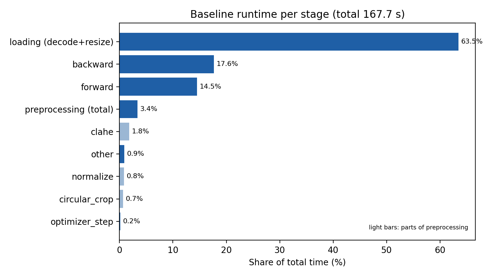
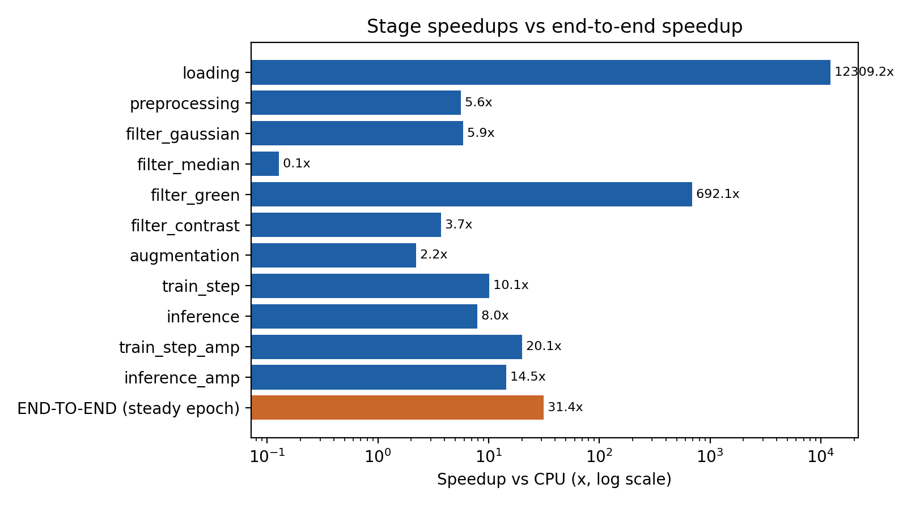
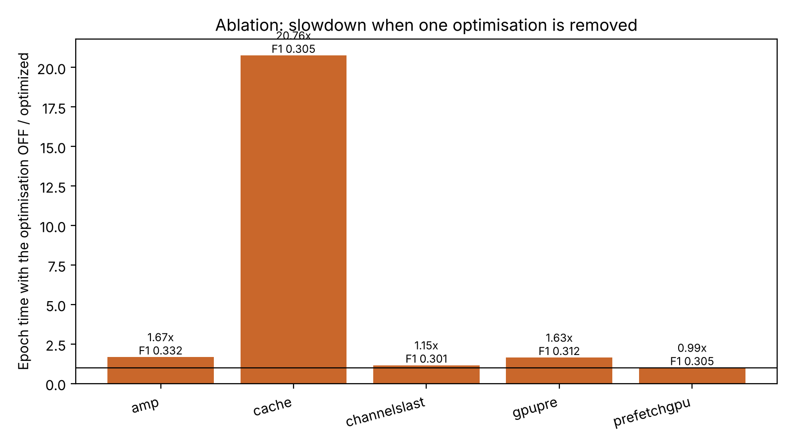
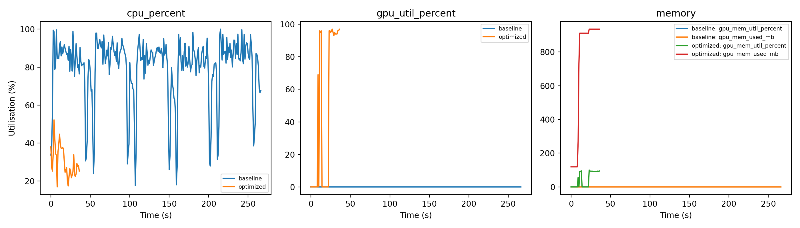
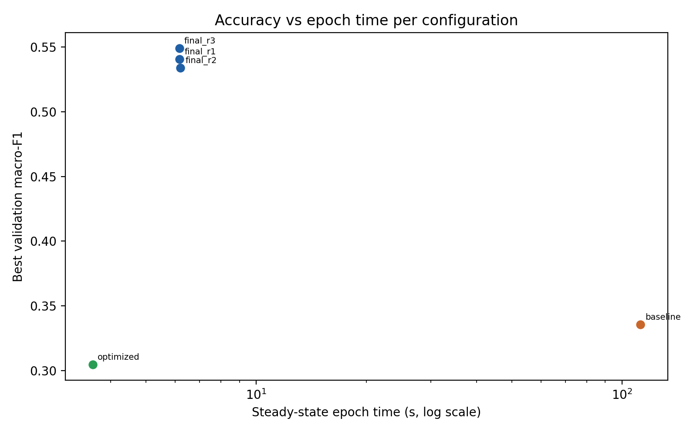

# GPU Acceleration of a Diabetic Retinopathy Classification Pipeline: Final Report

**Team:** Fatima Zahrae (P1: baseline, official measurements), Ghita (P2: data loading, cache,
figures), Inès (P3: GPU preprocessing, mixed precision), Lina (P4: GPU filters, model redesign,
experiments, GPU profiling). *(Add full names.)*

All official measurements were made on one laptop (Table 1). Exploratory runs on Google Colab
(Tesla T4) are kept in `results/colab_t4/`. They guided some decisions, but no number in this
report's tables comes from them unless it is marked "Colab". Every number points to a file in
`results/` or to an entry of `docs/lab_notebook.md`.

## 1. Abstract and objectives

We profiled and accelerated a CPU reference pipeline that classifies retinal fundus images into
five diabetic retinopathy grades (FDR26 dataset, 2,999 images). Profiling one baseline epoch showed
that the principal bottleneck was not the neural network but **image loading** (decoding and
resizing the full-resolution photos at every epoch): **63.5% of the epoch** (p = 0.635, Amdahl
bound 2.7× if only loading were fixed). Training (forward + backward) came second at 32%, and the
preprocessing we expected to dominate (CLAHE) took only 1.8%.

We therefore combined a decoded-image cache, GPU training, batched GPU preprocessing with a uint8
host-to-device copy, mixed precision (AMP) and `channels_last`. On the same laptop and with the
same model, the steady-state epoch went from **105.9 ± 5.8 s (CPU baseline, 3 runs) to 3.57 s**:
**29.7× end-to-end** (13.3× on the total 5-epoch run time, which includes one-time costs). Of this,
1.9× comes from moving the unchanged pipeline to the GPU and 15.7× from the pipeline optimizations.
The ablation shows that the cache contributes most: removing it alone makes the epoch 16–21×
slower.

To improve classification, we replaced the reference CNN by an ImageNet-pretrained **ResNet-18**
(lr 0.0001). On the test set, used once, macro-F1 rose from **0.288 to 0.518** (accuracy 0.332 →
0.517). The final configuration runs at **6.18 ± 0.02 s per epoch (17.1× faster than the
baseline)**. An important negative result: `channels_last`, which helps the reference CNN (1.15×),
made ResNet-18 **6.3× slower** on this GPU (38.8 s per epoch), because the half-precision cuDNN
batch-normalization kernels in NHWC layout took 89% of the GPU time. We found this only by
re-profiling, and we removed it from the final configuration.

## 2. Problem and pipeline description

**Task and data.** Five-class classification of diabetic retinopathy grades (0 to 4) from colour
fundus photographs (FDR26). The archive contains **2,999 images**, not the 3,000 the brief
describes: image `2T2SALA702` is listed in the metadata but missing. The classes are **not
balanced** (504 / 701 / 583 / 632 / 579 images per grade), so we use **macro-F1** as the main
quality metric. The data is split by **patient** (70 / 15 / 15%, `split_seed` 42) into **2,116
training, 425 validation and 458 test images** (1,342 / 287 / 289 patients). No patient appears in
two splits (checked in A1.4), so near-identical images of the same eye cannot inflate the scores.

**CPU reference implementation** (`src/`, `configs/baseline.yaml`, diagram in `docs/pipeline.md`):

| Module | Stage | Implementation |
|---|---|---|
| A | Loading | `DRDataset.load`: PIL decode of the full-resolution file, resize to 224 × 224 (bilinear), uint8 |
| B | Preprocessing | `preprocess_cpu`: CLAHE on the L channel of LAB (OpenCV), circular crop of the retina, ImageNet normalization |
| C | Filters | `filters_cpu`: Gaussian blur, median filter (5 × 5), green channel, contrast stretch (1–99th percentile). Timed as stand-alone stages, **not used in training** |
| D | Augmentation | random horizontal flip and rotation (±10°), on the fly, training split only (off in the baseline) |
| E | Training / evaluation | `ReferenceCNN` (3 conv blocks + MLP head, 0.62 M parameters, 1.01 GFLOPs per image), AdamW, cross-entropy, 5 epochs, batch 32, 2 DataLoader workers; `evaluate.py` on the test split |

Each training epoch processes 66 batches of 32 images (2,112 images, `drop_last`), then validates
on the 425 validation images. The best epoch, chosen on validation macro-F1, is saved, and only
that checkpoint is evaluated on the test set.

## 3. Experimental environment (Table 1)

**Table 1: Hardware and software configuration** (`results/environment.json`,
`environment/hardware_software.md`)

| Item | Value |
|---|---|
| CPU | 13th Gen Intel Core i5-13420H, 8 cores / 12 threads (PyTorch uses 8 CPU threads) |
| GPU | NVIDIA GeForce RTX 3050 6 GB Laptop GPU, 6.4 GB, compute capability 8.6, 20 SMs |
| RAM | 8 GB (7.4 GB already in use on average during the baseline, A2.8) |
| Disk | internal SSD (KIOXIA KBG60ZNV512G) |
| OS | Windows 11 (10.0.26300) |
| Driver / CUDA / cuDNN | 617.42 / 12.8 / 9.19.0 |
| Python / PyTorch / torchvision | 3.12.10 / 2.11.0+cu128 / 0.26.0+cu128 |
| NumPy / OpenCV / scikit-learn / Pillow | 2.5.4 / 5.0.0 / 1.9.1 / 13.0.0 |
| Image resolution / batch size / workers | 224 × 224 / 32 / 2 |
| Splits | 2,116 / 425 / 458 images, patient-level, `split_seed` 42 (identical in every run) |
| Training | 5 epochs; AdamW, no weight decay; lr 0.001 (reference CNN), 0.0001 (ResNet-18); seeds 42, 43, 44 for repeated runs |
| GPU settings | `cudnn.benchmark` on for GPU runs, off for the CPU baseline (A1.5); `torch.compile` off (needs Triton, not available on Windows) |
| Conditions | laptop plugged in, Windows power mode "Best performance", no other program running |

## 4. Baseline profiling

**Methodology.** We used three tools, each for a different question:

1. **Per-stage timers on one profiled CPU epoch** (`benchmarks/profile_baseline.py`, cProfile,
   `num_workers=0` so that all work runs in the profiled process): where does an epoch go?
2. **`line_profiler`** on `apply_clahe`: what inside the most expensive preprocessing step costs
   time?
3. **The PyTorch profiler** on the same baseline running on the GPU
   (`benchmarks/profile_gpu.py`, 5 warm-up + 15 profiled steps): how busy is the GPU?

Stage costs per image come from `benchmarks/benchmark_stages.py` (64 images, warm-up, repeats). CPU
and memory use come from the training monitor (`results/baseline/resources.csv`).

**Time distribution** (Figure 1, `results/profile_stages.json`, one profiled epoch of 167.7 s):

| Rank | Stage | Time (s) | % of epoch | Amdahl bound 1/(1−p) | Evidence |
|---|---|---|---|---|---|
| 1 | Loading (decode + resize) | 106.5 | 63.5% | 2.74× | `profile_stages.json`; 30.6–54.4 ms per image depending on the tool (A2.5, A3.5) |
| 2 | Backward | 29.6 | 17.6% | 1.21× | `profile_stages.json` |
| 3 | Forward | 24.3 | 14.5% | (fwd + bwd: 1.47×) | `profile_stages.json` |
| 4 | Preprocessing (CLAHE 3.0 s, normalize 1.4 s, crop 1.1 s) | 5.6 | 3.4% | 1.035× | `profile_stages.json`; `line_profiler` |
| 5 | Other + optimizer step | 1.7 | 1.1% | 1.01× | `profile_stages.json` |

*Figure 1: Share of each stage in one profiled CPU baseline epoch (light bars: the parts of
preprocessing).*

**Bottlenecks identified.**

- **Loading is the principal bottleneck.** Every epoch decodes the original full-resolution
  photographs again, then shrinks them to 224 × 224. This happens before any network computation
  and is repeated identically every epoch, so it is redundant work. Loading and training together
  take 95.6% of the epoch, so fixing both bounds the speedup at about 23×. That is why a cache and
  GPU training became the core of our design (`docs/design_proposal.md`).
- **Preprocessing is not the bottleneck.** This contradicted the team's predictions (A2.3, A2.10):
  CLAHE runs on the already resized image and takes 1.8% of the epoch. `line_profiler` showed that
  55% of CLAHE's own time goes into the RGB↔LAB colour conversions, not the histogram equalization.
- **The CPU is close to saturation and the GPU is idle.** In the CPU baseline the processor is 80%
  busy on average, with peaks at 100% (A2.8, Figure 5). Running the unchanged baseline on the GPU,
  the PyTorch profiler measured **88.7% GPU idle time**: 75 ms of GPU kernels per 689 ms training
  step. The GPU was waiting for the CPU to decode images. Each step also copied 19.3 MB of float32
  images (2.6 ms) to the GPU (`results/torch_profiler_baseline_rtx3050/`).

The profiled epoch (167.7 s) is longer than a real baseline epoch (105.9 s) because
`num_workers=0` removes the overlap between loading and training, and cProfile adds overhead. We
therefore use the profile for **shares** of time and the real runs for **durations** (A2.10).

**Baseline measurements** (3 runs, seeds 42 / 43 / 44, `results/baseline`, `results/A75_baseline_r2`,
`results/A75_baseline_r3`):

- **Steady epoch:** 105.9 ± 5.8 s, of which training is 90.0 s and validation 15.9 s
- **Training throughput:** 23.5 training images per second
- **Total time for 5 epochs:** 545.7 ± 19.2 s
- **Best validation macro-F1:** 0.324 ± 0.014

## 5. Redesign and optimization decisions

Each change answers a measurement from section 4. The design was written before the
implementation (`docs/design_proposal.md`) and tested one factor at a time.

| # | Change | Motivation (measured) | Expected effect | Trade-off |
|---|---|---|---|---|
| 1 | Decoded-image cache | loading = 63.5% of the epoch | the largest gain; at most 2.7× alone | 451 MB on disk; first run builds it (27 s) |
| 2 | Pinned memory, CUDA prefetcher, worker tuning | GPU 88.7% idle; 19.3 MB copied per step | overlap the copy with compute | RAM (8 GB machine); code complexity |
| 3 | GPU preprocessing + uint8 copy | preprocessing 3.4%; float32 copy 4× larger than uint8 | small directly (1.035×); fewer bytes over PCIe | GPU CLAHE not bit-identical to OpenCV |
| 4 | GPU training, AMP, `channels_last` | training = 32% of the epoch | up to 1.47× on the baseline, more once loading is fixed | numerical precision; layout depends on hardware |
| 5 | GPU filters (PyTorch + one custom Numba kernel) | Module C runs per pixel on the CPU | data-parallel stages should benefit | not used in training: no end-to-end effect |
| 6 | ResNet-18 pretrained, lr 0.0001; checkpoint chosen by macro-F1 | val macro-F1 0.32; reference CNN underfits (train acc 0.34) | better quality | 3.6× more FLOPs per image, 18× more parameters |

### 5.1 Decoded-image cache (P2)

`build_cache` (`src/data_loader.py`) decodes and resizes every image once into a memory-mapped
uint8 file of shape (N, 224, 224, 3). Its name contains an MD5 hash of the image list and the size,
so a changed dataset or resolution can never reuse a stale cache. Later epochs only read 150,528
bytes per image.

**Measured** (A3.5, `results/A35_*.csv`), for 64 images:

| Loading | Time |
|---|---|
| no cache | 3,480 ms |
| cache, warm OS file cache | 3.4 ms |
| cache, cold OS file cache | 12.0 ms |
| building the cache (2,116 training images, once) | 27 s |

The cache is about 1,000× faster than decoding (3,480 ms → 3.4 ms). The build pays for itself in
about a quarter of one epoch. The cache is byte-identical to direct decoding
(`test_cache_matches_direct_decode`).

**Trade-off:** 451 MB on disk for all splits, 3.8× smaller than the source images. It only works
because the resize happens before any random augmentation.

### 5.2 Data pipeline: pinned memory, prefetcher, workers (P2)

The DataLoader uses pinned memory on CUDA. A `CudaPrefetcher` (`src/prefetcher.py`) copies batch
i + 1 on a side stream while the model computes on batch i, which works because `non_blocking=True`
only overlaps with pinned memory (A5.11).

The workers / batch-size sweep (A5.8, A6.7, `results/sweep_workers.csv`, 30 batches per point):

- **All working combinations** of 0–4 workers and batch sizes 32 and 64 reach 384–416 images per
  second.
- **Batch 128** ran out of GPU memory.
- **4 workers with batch 64** crashed: a worker process ran out of RAM on the 8 GB machine.

We kept **2 workers and batch 32**: inside the best group (410 img/s, against 416 for the fastest
point, within noise), and with memory headroom.

### 5.3 GPU preprocessing and uint8 transfer (P3, P2)

`preprocess_batch_gpu` (`src/preprocess_gpu.py`) receives the **uint8** batch, converts it to float
on the GPU, then applies a batched CLAHE, the circular crop and normalization (plus augmentation
when enabled) to the whole batch at once. The batched CLAHE builds all tile histograms with one
`scatter_add_`.

**Why the uint8 copy matters:** it sends 4× fewer bytes over PCIe than float32 (A5.10: 0.32 instead
of 1.27 GB per epoch). Measured on this laptop (A4.14, `results/h2d_copy.csv`), a batch of 32 copies
in **0.56 ms as pinned uint8 against 3.80 ms as pageable float32 (6.8×)**. Pinned copies reach
about 9.4 GB/s, against 4.5–6.4 GB/s from pageable memory.

**On its own, CLAHE gains a lot:** in the batch-size sweep (A4.13, Colab draft), the GPU CLAHE ties
the CPU at batch 1 (2.24 vs 2.26 ms per image) and is 13–15× faster from batch 32 on.

**Correctness:** the GPU CLAHE uses a different colour-space approximation than OpenCV, so the test
checks a luminance correlation above 0.95 instead of identical pixels (A4.12).

### 5.4 GPU image filters and a custom kernel (P4)

The four Module C filters were rewritten as batched tensor operations (`src/filters_gpu.py`):

- **Gaussian blur:** one depthwise `conv2d` with a 5 × 5 kernel built from the 1-D Gaussian,
  reflect padding.
- **Green channel:** a slice.
- **Contrast stretch:** per-image 1st / 99th percentiles with `torch.quantile`, then a clamp.
- **Median filter:** `F.unfold` gathers every 5 × 5 neighbourhood, then `torch.median` takes the
  middle value.

**The PyTorch median is slower than OpenCV at every batch size** (A4.13, `results/sweep_median.csv`):
2.91 against 0.68 ms per image at batch 128. `unfold` writes a tensor 25 times larger than the image
and `torch.median` sorts it, while OpenCV's `medianBlur` is a specialized 8-bit algorithm.

**So we wrote a second version, a fused custom Numba CUDA kernel** (`src/filters_numba.py`, A4.11):

- one thread per output pixel, 16 × 16 blocks
- each thread reads its 25 neighbours with clamped coordinates (replicate padding) and sorts them
  in a private array

This avoids the 25× intermediate tensor entirely. On Colab (Tesla T4) it reached **0.55 ms per
image: 1.5–1.8× faster than OpenCV and 4.4× faster than the PyTorch version** from batch 8 on.

**Correctness:** all filters pass the CPU/GPU equivalence tests. The Numba kernel was also checked
in the CUDA simulator on odd image sizes.

**Trade-off:** the Numba kernel could not run on the official laptop. numba-cuda 0.30.4 is
incompatible with NumPy 2.5.4, and we did not downgrade NumPy to keep the measurement environment
unchanged. Its results are therefore from Colab only. None of the filters is used in training, so
they do not change the end-to-end time.

### 5.5 GPU training: mixed precision, channels_last, torch.compile (P3)

- **Mixed precision (AMP):** `torch.autocast` and a `GradScaler` run convolutions in float16 on the
  Tensor Cores.
- **`channels_last`:** the NHWC memory layout, which those kernels prefer.
- **`torch.compile`:** rejected, because it needs Triton, which is not available on Windows.

In a Colab micro-benchmark on the reference CNN (A6.1–A6.3), AMP alone gave 1.37×, and AMP plus
`channels_last` gave **1.75×** with 46% less GPU memory. `channels_last` alone in float32 was 9%
*slower*. Both were enabled in `configs/optimized.yaml`. The laptop results, including a case where
`channels_last` hurts, are in section 7.

### 5.6 Model and training redesign (P4)

**Model** (A6.6, `benchmarks/model_size.py`). ResNet-18 pretrained on ImageNet, last layer replaced
by a 5-class linear layer.

| | Reference CNN | ResNet-18 |
|---|---|---|
| Parameters | 0.62 M | 11.18 M (18×) |
| GFLOPs per 224 × 224 image | 1.01 | 3.63 (3.6×) |

Most of ResNet-18's parameters sit in deep layers that run on small 7 × 7 maps, so its cost grows
much less than its size. Pretraining should compensate for the small training set: about 2,100
images.

**Controlled experiments** (A6.8–A6.9). One change at a time, same splits, 5 epochs, on the laptop
GPU with the unoptimized pipeline, seed 42:

| Run | One change | Best val macro-F1 | Steady epoch (s) | Peak GPU memory |
|---|---|---|---|---|
| baseline on GPU | — | 0.319 | 56.5 | 712 MB |
| seed 43 (control) | seed | 0.314 | 55.3 | 712 MB |
| `exp_no_clahe` | no CLAHE | 0.333 | 56.4 | 712 MB |
| `exp_res160` | 160 × 160 images | 0.320 | 61.5 | 381 MB |
| `exp_augment` | augmentation | 0.319 | 64.9 | 712 MB |
| `exp_cosine` | cosine lr schedule | 0.329 | 60.5 | 712 MB |
| `exp_resnet18` | ResNet-18 (lr 0.001) | 0.519 | 56.5 | 885 MB |
| `exp_resnet18_lr1e-4` | lr 0.0001 (vs previous) | 0.510 | 55.6 | 885 MB |
| `exp_resnet18_lr1e-4_augment` | + augmentation (vs previous) | 0.536 | 57.2 | 885 MB |

**Only the model change is clearly larger than the noise.** The best validation F1 of the
reference CNN varies by up to 0.03 across seeds (0.308 / 0.329 / 0.336 for seeds 44 / 43 / 42 on
the CPU), so the input-representation and schedule changes (−0.005 to +0.014) are not conclusive.
ResNet-18 improves macro-F1 by about +0.20.

**Input representation:** neither 160 × 160 images nor dropping CLAHE changed quality measurably.
The epoch time hardly moved either, because in this unoptimized pipeline most of the epoch is
spent decoding the full-resolution photographs, whatever the network input size.

**Training strategy:**

- **Learning rate:** lr 0.001 was unstable for the pretrained network on Colab (F1 0.51 → 0.29 →
  0.45 across epochs). The laptop run did not show this, but 0.0001 is the standard fine-tuning
  rate and was stable on both machines, so we kept it.
- **Overfitting:** with lr 0.0001, ResNet-18 overfits (training accuracy 0.97 against about 0.51 on
  validation).
- **Augmentation** halves this gap (training accuracy 0.79), and its F1 gain (+0.026) is within
  single-seed noise. We left it out of the final recipe, so that the final model differs from the
  reference only by the model and its learning rate. We report it as a promising, unconfirmed
  option.

**Class-sensitive selection:** because the classes are not balanced, the checkpoint is chosen on
validation **macro-F1** instead of accuracy (`src/train.py`). On Colab, accuracy-based selection
had kept an epoch 0.02 F1 below the best.

### 5.7 Final configurations

- **`configs/optimized.yaml`:** the baseline model and recipe with every pipeline optimization on
  (cache, pinned memory and prefetcher, GPU preprocessing, AMP, `channels_last`). Used to measure
  the pure pipeline speedup.
- **`configs/final_resnet18.yaml`:** the same pipeline with ResNet-18 and lr 0.0001, and
  **`channels_last` off** (section 7.3).

## 6. Benchmarking methodology

- **Same machine and conditions** for every official CPU and GPU number (Table 1): plugged in, same
  power mode, no other program running. Colab drafts were never mixed into the comparisons.
- **Synchronization.** All GPU timings use `GpuTimer` (`src/utils.py`), which calls
  `torch.cuda.synchronize()` before starting and before stopping the clock. Without it,
  asynchronous kernel launches would be timed instead of their execution.
- **Warm-up.**
  - Stage benchmarks discard 2 warm-up runs (1 for the training step) before timing.
  - Training runs report **epoch 0 as the cold epoch** (CUDA context, cuDNN autotuning, first file
    reads) and the **mean of epochs 1–4 as the steady epoch**.
  - The profiler discards 5 warm-up steps and records 15.
- **Timing boundaries.**
  - *Stage benchmarks* (`benchmarks/benchmark_stages.py`): one batch of 64 training images per
    stage, 5 repeats (3 for training and inference).
    - The GPU *preprocessing* row includes the host-to-device copy.
    - The filter and augmentation rows start from data already on the GPU, so they measure the
      stage itself.
    - The *loading* row of the optimized pipeline reads the uint8 cache.
  - *Training runs:* `train_time_s` covers the whole training loop of an epoch, including waiting
    for the loader and all host-to-device copies, and `val_time_s` the validation pass. The *steady
    epoch* is training + validation, and the *wall time* is the whole run including setup.
- **Repetitions and variability.** The CPU baseline and the final configuration were each run 3
  times (seeds 42, 43, 44), reported as mean ± sample standard deviation. Ablation and exploration
  runs are single runs, and we compare them against the seed-to-seed spread above. The protocol
  script `benchmarks/benchmark_end_to_end.py` is the formal version of this measurement: for the
  CPU baseline and the optimized pipeline, 1 discarded warm-up run, then 3 timed repeats of 2
  epochs each, same seed (`results/end_to_end_runs.csv`, `results/end_to_end.csv`, section 7.2).
- **GPU idle fraction** (profiler): 1 − (union of the GPU kernel and copy intervals) / (profiled
  wall time). Overlapping kernels are counted once, and the profiler's own step markers are
  excluded.
- **Test set:** used **once** per final model (`src/evaluate.py`), never for any decision.
- **Correctness checks:**
  - `tests/test_cpu_gpu_equivalence.py`: preprocessing and filters within tolerances.
  - `tests/test_data_pipeline.py`: cache identical to direct decoding; patient-level split.
  - On the laptop GPU: **24 passed, 1 skipped** (`results/pytest_output.txt`). The skipped test is
    the Numba median kernel, because numba-cuda cannot run there (section 5.4). On Colab, the Numba
    test passed as well.

## 7. Results and comparisons

### 7.1 Stage-level performance

**Table 2: Stage-level performance** (stages: `results/timing.csv`, 64 images, CPU vs RTX 3050;
training, evaluation and total: training runs, CPU baseline mean of 3 runs vs `optimized`, same
reference CNN)

| Pipeline stage | CPU baseline | Optimized | Speedup |
|---|---|---|---|
| Image loading (64 images) | 1,962 ms (decode + resize) | 3.0 ms (read from cache)* | 659×* |
| Host-to-device copy (64 images, uint8, pinned) | — (not applicable on CPU) | 1.2 ms | — |
| Preprocessing (64 images, GPU row includes the copy) | 128.1 ms | 24.5 ms | 5.2× |
| Filtering: Gaussian | 16.5 ms | 2.7 ms | 6.1× |
| Filtering: median (PyTorch) | 41.6 ms | 319.6 ms | **0.13×** |
| Filtering: green channel | 6.5 ms | 0.26 ms | 25× |
| Filtering: contrast stretch | 106.0 ms | 29.7 ms | 3.6× |
| Filtering: all four | 170.6 ms | 352.2 ms | 0.48× |
| Augmentation (64 images) | 20.3 ms | 8.7 ms | 2.3× |
| Training step (64 images, fp32 / AMP) | 1,322 ms | 141.3 / 68.4 ms | 9.4× / 19.3× |
| Inference (64 images, fp32 / AMP) | 410 ms | 49.7 / 26.8 ms | 8.2× / 15.3× |
| **Training per epoch** (2,112 images) | 90.0 ± 2.9 s | 3.19 s | **28.2×** |
| **Evaluation per epoch** (425 validation images) | 15.9 ± 3.0 s | 0.38 s | **41.8×** |
| **Total training run** (5 epochs, incl. setup and cold epoch) | 545.7 ± 19.2 s | 41.1 s | **13.3×** |

\* *The loading speedup measures the cache (algorithmic redesign), not the GPU: both rows run on
the CPU. The cache file was warm in the OS memory. With a cold OS cache, A3.5 measured 12.0 ms for
64 images. The filters are not part of the training pipeline (section 5.4).*

*Figure 2: Stage speedups (blue, from Table 2) against the end-to-end steady-epoch speedup
(orange). The orange bar uses the seed-42 baseline run (112.3 s → 3.57 s, 31.4×). With the mean of
3 baseline runs it is 29.7×. Log scale.*

**Stage results are not the end-to-end result.** The median filter becomes slower, while the
training step gains 19×. Applying Amdahl's law to the shares of Figure 1 with the measured stage
speedups gives a predicted end-to-end speedup of about 33×:

- loading: 659×
- training: 28×
- preprocessing: 5.2×
- the remaining 1.1% unchanged

S = 1 / (0.635/659 + 0.321/28 + 0.034/5.2 + 0.011/1) ≈ 33×.

The measured speedup is 29.7×. The prediction is slightly optimistic because the profile shares
come from an epoch without worker overlap, and because validation, which is not in the profile,
is also part of a real epoch.

### 7.2 End-to-end speedup, training throughput and memory

**Table 3a: End-to-end runs.** Steady = mean of epochs 1–4, train + validation. Mean ± std over 3
runs where available.

| Configuration | Model | Runs | Steady epoch (s) | Cold epoch (s) | 5-epoch run (s) | Train img/s | Peak GPU memory | Speedup (steady / run) |
|---|---|---|---|---|---|---|---|---|
| CPU baseline | ref. CNN | 3 | 105.9 ± 5.8 | 121.1 ± 8.1 | 545.7 ± 19.2 | 23.5 | — | 1× / 1× |
| Baseline on GPU (device only) | ref. CNN | 2 | 55.9 ± 0.8 | 74.1 ± 5.6 | 297.9 ± 8.8 | 45.8 | 712 MB | 1.9× / 1.8× |
| Optimized pipeline | ref. CNN | 1 | 3.57 | 26.1 | 41.1 | 662 | 476 MB | **29.7× / 13.3×** |
| Final, `channels_last` on (first version) | ResNet-18 | 3 | 38.84 ± 0.01 | 57.4 ± 1.0 | 234.5 ± 37.0 | 55 | 614 MB | 2.7× / 2.3× |
| **Final** | ResNet-18 | 3 | **6.18 ± 0.02** | 28.7 ± 0.4 | 54.1 ± 0.3 | 370 | 616 MB | **17.1× / 10.1×** |

Separating the effects (A6.10), with the reference CNN on both sides unless stated:

- **Device effect:** the unchanged pipeline on the GPU is only **1.9×** faster. The GPU waits for
  the CPU to decode images (88.7% idle, section 4).
- **Pipeline optimizations** (cache, GPU preprocessing, AMP, `channels_last`, prefetcher):
  **15.7×** on top of that (55.9 → 3.57 s).
- **Total for the same model:** 29.7×.
- **Model effect:** ResNet-18 costs 1.73× more time per epoch than the reference CNN in the same
  optimized pipeline (6.18 vs 3.57 s). That is much less than its 3.6× FLOPs, because part of the
  epoch is not convolution work.

**The steady speedup is the one to quote for throughput, but the wall-time speedup is lower.** The
5-epoch run includes one-time costs that the optimizations shrink much less: setup, the cold first
epoch (cuDNN autotuning, first reads of the cache file, and a first validation pass 20× slower
than the next ones) and worker start-up. In the final configuration the cold epoch alone (28.7 s)
is more than half of the 54-second run. Longer training would bring the wall-time speedup closer to
the steady one.

**Table 3b: Benchmark protocol** (`benchmarks/benchmark_end_to_end.py`, `results/end_to_end.csv`).
Each configuration ran 1 discarded warm-up run, then 3 timed repeats of 2 epochs each, seed 42. With
2 epochs, the steady epoch is epoch 1.

| Configuration | Repeats | Steady epoch (s) | Cold epoch (s) | 2-epoch run (s) | Speedup steady / run |
|---|---|---|---|---|---|
| CPU baseline | 3 | 96.3 ± 1.0 | 112.9 | 209.3 ± 0.5 | 1× / 1× |
| Optimized pipeline | 3 | 3.47 ± 0.01 | 20.5 | 24.0 ± 0.8 | **27.7× / 8.7×** |

The protocol confirms the training runs: a **28–30× steady-epoch speedup** for the same model, with
a very small spread on the GPU (±0.3%). It also shows the effect of one-time costs even more
clearly. Over only 2 epochs, the cold epoch is 85% of the optimized run, so the wall-time speedup
drops to 8.7×. The baseline's steady epoch is shorter here (96.3 s) than in the 5-epoch runs
(105.9 s, which average 3 seeds and epochs 1–4), so we compare each speedup only within its own
protocol.

**Memory:**

- **GPU:** AMP reduces peak memory from 712 MB (fp32 baseline on GPU) to 476 MB. ResNet-18 needs
  616 MB with AMP against 885 MB in fp32. Everything fits comfortably in 6 GB.
- **Disk:** the cache adds 451 MB.
- **RAM:** the 8 GB of RAM, not the GPU, limited the number of workers.

### 7.3 Ablation: what each optimization contributes

*Figure 4: Slowdown of the steady epoch when one optimization is switched off in the optimized
pipeline (reference CNN, single runs), with the run's best validation macro-F1.*

| Switched off (one at a time) | Steady epoch (s) | Slowdown vs optimized (3.57 s) | Best val F1 |
|---|---|---|---|
| Cache | 74.2 (rerun: 56.8) | **20.8×** (15.9×) | 0.305 |
| AMP | 5.96 | 1.67× | 0.332 |
| GPU preprocessing | 5.84 | 1.63× | 0.312 |
| `channels_last` | 4.11 | 1.15× | 0.301 |
| CUDA prefetcher | 3.56 | 1.00× | 0.305 |

- **The cache matters by far the most.** Without it, decoding becomes the bottleneck again.
- **GPU preprocessing gains 1.6×,** although preprocessing was only 3.4% of the baseline epoch. Once
  loading and training are fast, CPU preprocessing becomes a large share of what remains. This is
  Amdahl's law working in the other direction: the bottleneck shifts.
- **The prefetcher brings nothing measurable** here: with pinned uint8 batches the copy is 0.7 ms
  per 48 ms step.
- **Quality:** all F1 differences are within the seed-to-seed spread of the reference CNN (0.31 to
  0.34), so none of these optimizations changes quality.

**`channels_last` with ResNet-18: a measured pessimization.** The first final configuration kept
`channels_last` and ran at 38.8 s per epoch, 6.3× slower than without it (6.12 s, run
`A76_channels_last_off`; the 3 final runs confirm 6.18 s). The re-profile explains why (A7.7,
`results/A77_profiler/`):

- the GPU was busy 93.5% of the time
- **89% of the GPU time went to cuDNN batch-normalization kernels** in half precision
- batch normalization took 10.3 ms per call forward and 15.9 ms backward, against 0.4–0.9 ms for a
  convolution

The reference CNN has no batch normalization, which is why `channels_last` helped it. We therefore
set `channels_last: false` in the final configuration. We did not identify the cause inside cuDNN
(it may depend on the cuDNN version), and the final configuration has not been re-profiled yet.

*Note on two A7.6 runs:* `A76_amp_off` and `A76_cache_off` were intended as ablations of the
ResNet-18 configuration, but their configuration files are derived from `optimized.yaml` (reference
CNN). They are therefore reference-CNN ablations, consistent with the table above, which explains
their low F1 (0.33 and 0.30).

### 7.4 Re-profiling: did the bottleneck move?

| | Baseline on GPU | Optimized (ref. CNN) | First final (ResNet-18, `channels_last` on) |
|---|---|---|---|
| Wall time per step | 689 ms | 54.4 ms | 623 ms |
| GPU kernel time per step | 75 ms | 45.5 ms | 588 ms |
| **GPU idle fraction** | **88.7%** | **16.3%** | **6.5%** |
| Host-to-device copy per step | 19.3 MB, 2.6 ms | 4.8 MB, 0.68 ms | 4.8 MB, 0.54 ms |

(`results/torch_profiler_baseline_rtx3050/`, `results/torch_profiler_optimized_rtx3050/`,
`results/A77_profiler/`)

**Yes, the bottleneck moved:**

- **From the CPU to the GPU.** In the baseline the GPU was idle 89% of the time, waiting for
  decoding. In the optimized pipeline it is busy 84% of the time, and the copy is about 1% of a
  step.
- **What remains** is mostly GPU computation: convolutions and, for ResNet-18, batch
  normalization.
- **The CPU is no longer saturated:** about 29% busy on average while the GPU trains (22–45%),
  against 80% in the baseline (Figure 5).

*Figure 5: CPU utilization, GPU utilization and GPU memory over time, CPU baseline (564 s) vs
optimized pipeline (41 s) (`resources.csv` of both runs). The baseline's regular CPU dips, about
every 110 s, probably correspond to the end of each epoch (validation and worker restart); we did
not check this.*

### 7.5 Classification quality

**Table 3: Classification quality on the test set** (458 images, used once; `results/baseline/metrics.json`,
`results/final_r1/metrics.json`)

| Metric | Baseline model (reference CNN, CPU) | Final model (ResNet-18, seed 42) |
|---|---|---|
| Accuracy | 0.332 | **0.517** |
| Macro-precision | 0.275 | **0.517** |
| Macro-recall | 0.346 | **0.521** |
| Macro-F1 | 0.288 | **0.518** |
| Recall per grade 0 / 1 / 2 / 3 / 4 | 0.53 / 0.32 / **0.00** / 0.21 / 0.67 | 0.49 / 0.50 / 0.31 / 0.53 / 0.78 |
| Errors within one grade of the truth | 40% | 72% |
| Test inference time (458 images, incl. loading) | 157.9 s | 13.1 s |

Confusion matrices (rows = true grade, columns = predicted grade):

| Baseline | 0 | 1 | 2 | 3 | 4 | | Final | 0 | 1 | 2 | 3 | 4 |
|---|---|---|---|---|---|---|---|---|---|---|---|---|
| **0** | 41 | 9 | 0 | 13 | 15 | | **0** | 38 | 21 | 14 | 5 | 0 |
| **1** | 32 | 35 | 0 | 11 | 30 | | **1** | 29 | 54 | 13 | 9 | 3 |
| **2** | 32 | 11 | 0 | 20 | 26 | | **2** | 14 | 19 | 28 | 26 | 2 |
| **3** | 33 | 10 | 0 | 21 | 37 | | **3** | 5 | 7 | 21 | 53 | 15 |
| **4** | 6 | 7 | 0 | 14 | 55 | | **4** | 0 | 0 | 2 | 16 | 64 |

- **The baseline never predicts grade 2** and confuses distant grades: it predicts grade 4 for 15
  grade-0 images.
- **The final model improves every grade except grade 0.** Its mistakes are mostly between
  neighbouring grades (72% of errors), as expected for an ordinal severity scale.
- **The test score is slightly below validation** (validation macro-F1 0.541 ± 0.008 over 3 seeds),
  as expected, since the checkpoint was selected on validation. P1's prediction, written before the
  evaluation, was 0.45–0.52 (A7.8).

*Figure 3: Best validation macro-F1 against steady epoch time for every configuration we ran (log
scale).*

Figure 3 shows the trade-off:

- **Pipeline optimizations move points left** (faster) without changing their height.
- **The model change moves points up** for a moderate cost.
- **The final configuration (top left)** is both 17× faster and 0.22 F1 better than the baseline.

## 8. Discussion and critical analysis

**Why did some stages benefit more than others?** Gains follow the amount of independent,
regular work per byte moved:

- **Training and inference** (many large convolutions) gain 8–10× in fp32 and 15–19× with AMP.
- **Light per-pixel operations** gain only 2–6× on a 64-image batch: augmentation, contrast
  stretch, Gaussian blur. Their run time is dominated by kernel launches and memory traffic, not
  arithmetic.
- **The PyTorch median filter loses** because its formulation (`unfold` + sort) multiplies memory
  traffic by 25, while the CPU uses a specialized algorithm. When we removed that traffic with a
  fused kernel, the same GPU beat the CPU (section 5.4). This is an algorithmic gain, not a hardware
  one.
- **CLAHE** goes from a tie at batch 1 to 13–15× at batch 32. Batching amortizes the launch
  overhead.

**Did transfer, launch or synchronization overhead reduce the gains?**

- **Transfers:** they were reduced at the source, by copying uint8 instead of float32 (4× fewer
  bytes) from pinned memory. They are now about 1% of a step, which is why the prefetcher brought no
  measurable gain.
- **Launch overhead:** visible at small batch sizes (CLAHE and median at batch 1).
- **One-time costs** dominate the short runs: the cold epoch is half of the final run's wall time.

**Did the bottleneck shift?** Yes, twice:

1. The cache removed decoding, which made training and then CPU preprocessing the next limits.
   Hence the 1.6× from GPU preprocessing, a stage that was 3.4% of the baseline.
2. After GPU training and AMP, the GPU is the busy resource (84–94%).

For ResNet-18, re-profiling found a new, unexpected bottleneck (batch normalization in NHWC) that
no prediction had anticipated.

**Was the isolated improvement reflected end-to-end?** Only partly, and only in combination:

- **The GPU alone:** 9–19× on the training step but **1.9×** end-to-end, because the GPU was
  starved (Amdahl, p = 0.32 for training).
- **The cache alone:** bounded at 2.7×.
- **Together:** 29.7×, close to the Amdahl estimate from the measured stage speedups (about 33×).

**Algorithmic vs hardware gains:**

| Gain | Type |
|---|---|
| cache, uint8 transfer, fused median kernel, checkpoint selection | algorithmic or data-movement redesign |
| GPU execution: 1.9× alone, 9–19× per training step | hardware |
| AMP (1.67×) | hardware feature (Tensor Cores) |
| ResNet-18 (+0.23 test macro-F1) | learning method, not acceleration |

The largest single contribution, the cache, is algorithmic and would help on any machine.

**Classification quality:**

- **Did preprocessing preserve retinal structures?** GPU CLAHE is not bit-identical to OpenCV but
  stays within the tested tolerance, and quality is unchanged when CLAHE is moved to the GPU
  (ablation) or removed (A6.9). At this resolution and training budget, CLAHE does not measurably
  help or hurt.
- **Where did the macro-F1 gain come from?** The architecture: pretraining on ImageNet. Precision
  (AMP), preprocessing location and the pipeline optimizations change F1 by less than the seed
  variation. The augmentation gain is within noise.
- **Per-grade recall improved** for grades 1–4, including grade 2, which the baseline never
  predicted.
- **Was the evaluation independent of model selection?** Yes. Model choices and checkpoint
  selection used only the validation split. The test set was evaluated once per final model, after
  all decisions were taken.

**Engineering trade-offs:**

- **Storage and memory:** the cache costs 451 MB of disk. AMP *reduces* GPU memory. The tight
  resource was the laptop's 8 GB of RAM (workers, pinned memory), not the GPU.
- **Complexity and portability:** the GPU preprocessing re-implements OpenCV functions and needs
  tolerance-based tests. The Numba kernel adds a dependency that broke on the official machine.
  `torch.compile` is unavailable on Windows.
- **Hardware dependence:** `channels_last` helped the reference CNN and hurt ResNet-18 on the same
  GPU, and the CPU/GPU balance of the median filter changed between the laptop and Colab (4× vs 2×
  in favour of the CPU). Format and precision choices must be re-measured on each GPU, whereas the
  cache and the uint8 transfer are hardware-independent.
- **Was the complexity justified?** The cache and GPU training clearly were (each more than an
  order of magnitude). AMP and GPU preprocessing were (1.6–1.7× each). The prefetcher was not, on
  this workload. The GPU filters are only educational, since they are not in the training pipeline.

## 9. Limits and threats to validity

### 9.1 Dataset

- **Not the dataset described in the brief.** The FDR26 archive contains **2,999 images**, not
  3,000, and the five grades are **not balanced** (504 / 701 / 583 / 632 / 579 images). This is why
  we report **macro-F1** and select checkpoints on it.
- **Small size.** About 400 to 700 training images per grade and 425 validation images. That is
  enough for an educational benchmark, but not to establish how a model would generalize.
- **A single source.** Image quality, cameras, acquisition conditions and patient populations in
  other hospitals could lead to different results.
- **Leakage is controlled, not excluded.** Images of the same patient always stay in the same
  split (A1.4). Other correlations, such as the same camera session, cannot be ruled out.

### 9.2 Model and clinical use

- **This is not a diagnostic tool.** The final model reaches a test macro-F1 of 0.52, against 0.29
  for the reference CNN: a clear improvement, but far from clinical requirements.
- **Overfitting.** ResNet-18 reaches about 96% training accuracy against 50–55% on validation.
  Augmentation halves this gap, but its quality gain was not confirmed within the 5-epoch budget.
- **Scores are not clinical utility.** We did not study per-grade sensitivity or the cost of
  specific errors, such as missing a severe case versus over-grading a mild one.

### 9.3 GPU and performance measurements

- **Results depend on the hardware.** All official numbers come from one laptop. The same median
  filter was 2× slower than the CPU on Colab and 4× slower on the laptop, and `channels_last` changed
  sign between two models on the same GPU. Our speedups cannot be transferred as such to another
  machine, driver or cuDNN version.
- **Measurement conditions matter.**
  - A second run of the median sweep in different power or thermal conditions was about 60% slower
    on the GPU. It was discarded.
  - The two cache-off ablation runs differ by 30% (74.2 vs 56.8 s).
  - CPU stage timings moved by 5–40% between sessions (A2.5).
  - We therefore compare only numbers from the same session or the same protocol, and report the
    run-to-run spread.
- **Laptop constraints.** The 8 GB of RAM limited workers and pinned memory, and the 6 GB GPU
  limited the batch size. `torch.compile` could not be used (no Triton on Windows).
- **Not every component ran everywhere.** The Numba CUDA kernel could not run on the laptop
  (numba-cuda 0.30.4 is incompatible with NumPy 2.5.4), so its results come from Colab only.
- **Numerical differences.** GPU CLAHE uses a different colour conversion than OpenCV, AMP computes
  in 16-bit, and cuDNN autotuning may pick different algorithms between runs. We checked that
  results stay within test tolerances and that quality stays within seed variation, not that they
  are identical.

### 9.4 Methodology

- **Few repetitions.**
  - The baseline and the final configuration have 3 runs each.
  - The optimized pipeline has one 5-epoch run, plus 3 repeats in the benchmark protocol
    (Table 3b). The ablation and exploration experiments have one run each.
  - The seed-to-seed spread of the best validation F1 is up to 0.03 for the reference CNN, so
    smaller differences (CLAHE, resolution, schedule, augmentation) are not conclusive. Only the
    model change is clearly above it.
- **Short training budget.** All models were trained for 5 epochs and had not converged. Longer
  training could change the ranking of some options (e.g. augmentation) and would also raise the
  wall-time speedup.
- **Checkpoint selection is optimistic.** The best epoch on validation slightly overestimates the
  validation score. The test set is therefore used once, never for selection.
- **Profiling changes what it measures.** cProfile needs `num_workers=0` and adds overhead (167.7 s
  vs 105.9 s per epoch). We use it for shares only. The PyTorch profiler adds about 8% per step.
- **The final configuration was not re-profiled** after `channels_last` was turned off. Its
  bottleneck is inferred from the ablation, not measured.
- **Predictions were not always written before the run.** The notebook says so explicitly in each
  case (e.g. A2.6, A4.11, A1.7).

### 9.5 Scope

Within the project's duration we did not:

- compare several GPU architectures on the final pipeline
- train longer or with more seeds
- optimize inference separately from training
- decode images on the GPU (e.g. NVIDIA DALI)
- measure energy consumption

## 10. Conclusion and future work

**Contribution.** We turned a CPU pipeline running at 23.5 training images per second into a GPU
pipeline running at 662 (reference CNN) or 370 (ResNet-18). The steady epoch is **29.7× faster**
for the same model, and **17.1× faster with a better model** whose test macro-F1 rose from 0.288 to
0.518.

**Strongest evidence:**

1. **The profile:** loading was 63.5% of the epoch and the GPU was 88.7% idle.
2. **The device-only run:** 1.9×. A GPU alone does not fix a data-bound pipeline.
3. **The ablation:** the cache is the most important optimization (16–21×).
4. **The re-profiles:** the GPU went from 89% idle to 84% busy, and they exposed a format choice
   that slowed ResNet-18 down 6.3×.

**Lessons learned:**

- **Measure before optimizing.** All four of us predicted the wrong bottleneck.
- **Accelerating a stage is not accelerating the application** (Amdahl).
- **Optimizations interact with the model and the hardware.** `channels_last` helped one network
  and hurt another.
- **Re-profile after every major change.**

**Next steps:**

- re-profile the final configuration
- confirm augmentation and longer training with several seeds
- GPU image decoding for the first epoch and the cache build
- a separate inference-only optimization
- testing the conclusions on another GPU

## Use of AI tools

*(Draft: to be adjusted by the team.)* As encouraged by the course, we used an AI assistant
(Claude, Anthropic) throughout the project:

- explaining concepts (GPU memory, profiling, Amdahl's law, PyTorch operations)
- reviewing our code and pointing out errors
- scaffolding some scripts
- writing parts of the documentation and drafting this report from our lab notebook and measured
  results

All measurements were run by the team on the hardware described above. The experimental decisions
were discussed and taken by the team. We checked every number in this report against the files in
`results/`.
